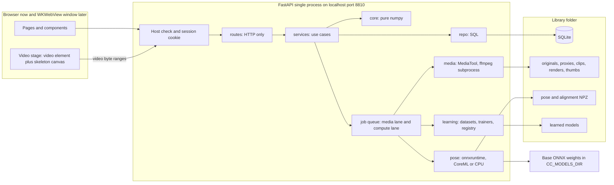
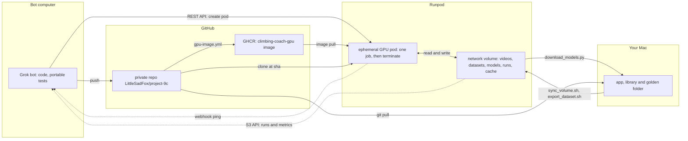
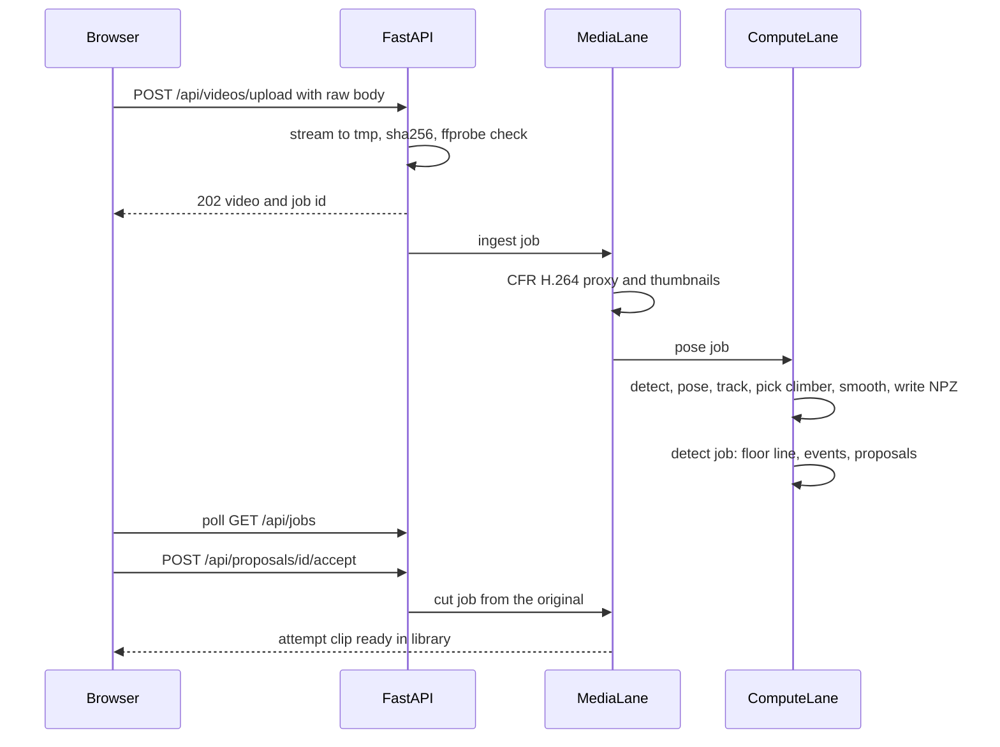
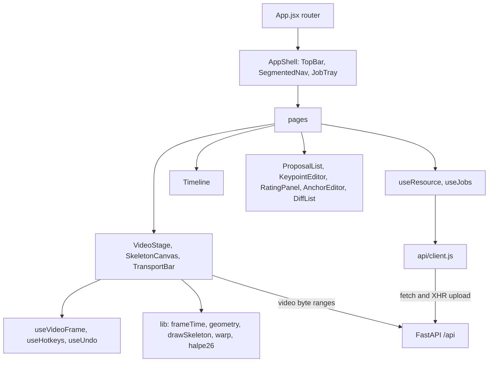
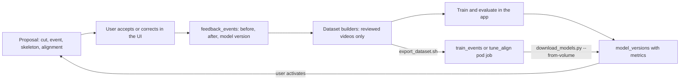

# Architecture

This file describes Climbing Coach.
Follow `coding_plan.md` when this file and an older plan disagree.
Write in ASD-STE100 Simplified Technical English.

## 1. System

The app is a local FastAPI process plus a browser UI.
A later Phase 5 launcher opens the same UI in a WKWebView window.

The server binds to `127.0.0.1:8810`.
The Vite dev server uses port `8811` and proxies `/api`, `/auth`, and `/health`.

## 2. Three tiers

The bot computer is Debian Linux x86_64 with CPU only.
It has no CoreML, no VideoToolbox, no Safari, no model weights, and no sample videos.

Pods run only pushed commits.
Push first.
Then the Runpod bot starts the pod with that sha.

The bot never handles footage.
The bot reads run folders and metrics only.

## 3. Backend layers

Call layers in this order:

1. `routes` — HTTP only.
2. `services` — use cases. Services own transactions.
3. `core`, `pose`, `media`, `learning`, `repo`, `storage`.

Routes call services.
Services call `core`, `pose`, `media`, `learning`, `repo`, and `storage`.
Routes never run SQL.
Routes never touch files.

`core/` imports only numpy and the Python standard library.
A layering test must enforce that rule.

`media/` sits behind a `MediaTool` protocol.
The protocol methods are `probe`, `make_proxy`, `cut_clip`, `extract_frame`, `thumbnails`, and `render`.
API tests use `FakeMediaTool`.
They do not need ffmpeg.

`pose/` sits behind a `PoseEstimator` protocol.
`RtmlibEstimator` is the real backend.
It calls rtmlib `YOLOX` and `RTMPose` directly.
Do not use rtmlib `PoseTracker`.
`FixtureEstimator` is the test backend.
Set `CC_POSE_BACKEND=fixture` to use it.

`create_app(settings, media=..., estimator=...)` takes both dependencies.
Tests inject the fakes through those arguments.

Mac-only code lives in `launcher/` or behind `sys.platform == "darwin"`.
`backend/app` never imports Mac-only code at module level.

## 4. Jobs

Long work runs only as jobs.
The request returns `202` with a job id.

There are two lanes.
Each lane has one worker thread.

- `media`: proxy, cut, render
- `compute`: pose, detection, training

Jobs persist in SQLite.
A partial unique index allows only one queued or running job per kind and entity.
At start-up, `running` jobs go back to `queued`.

Each job writes to `*.tmp` and then calls `os.replace`.
A job can safely re-run after a crash.

One `sqlite3` connection serves each request.
One connection serves each worker.
Use `journal_mode=WAL`, `foreign_keys=ON`, and `busy_timeout=5000`.

## 5. Pipeline from import to attempt clip

## 6. Time base and coordinates

The canonical timeline is the proxy frame grid.

The proxy has a constant frame rate `proxy_fps` (default 30).
It has no B-frames.
It has a keyframe every 15 frames.
Timestamps start at 0.
Orientation is upright.
The long side is `proxy_long_side` (default 1280).

Every `frame` in the DB and the API is a proxy frame index.

In the browser, `frame = round(mediaTime × fps)` from `requestVideoFrameCallback`.
Seek with `currentTime = (frame + 0.5) / fps`.

Cuts use `seconds = frame / fps`.
The clip is cut from the original with a re-encode.
Accuracy is ±1 proxy frame.
Clips play back with `frame = start_frame + round(t × fps)`.

Keypoints are in proxy pixels.
The UI scales them by the size ratio to the clip or the original.

## 7. Storage

Nothing persistent lives in the repo.

Library folder contents:

- `library.sqlite3`
- `originals/<video_id>.<ext>`
- `proxies/<video_id>.mp4`
- `thumbs/<video_id>/<i>.jpg`
- `pose/<video_id>/<run_id>.npz` plus an `.effective.npz` cache
- `align/<comparison_id>.npz`
- `clips/<attempt_id>_v<n>.mp4`
- `renders/<render_id>.mp4`
- `models/<family>/<version>/`
- `exports/`
- `trash/`
- `tmp/` (cleared at start-up)

File names never come from user input.
The original file name is stored only in the DB.

Store pose tracks as NPZ files.
Do not store pose tracks as Parquet.

Learned models are ONNX plus JSON only.
The app never loads a pickle or joblib file.

## 8. Security

This is a local app that holds private videos.

- Bind to `127.0.0.1` only.
- Allow only `127.0.0.1:<port>` and `localhost:<port>` in the Host header.
- The launcher opens `/auth/launch?token=…`.
  That route sets an HttpOnly, SameSite=Strict cookie named `cc_session`.
  Every `/api` route requires that cookie.
- Do not send CORS headers.
- Limit upload size with `CC_MAX_UPLOAD_GB` (default 8).
- Validate uploads with ffprobe.
- Run ffmpeg as an argument list with a timeout.
  Never run ffmpeg through a shell.

## 9. Frontend

Routes:

- `/library` and `/library/boulders/:boulderId`
- `/videos/:videoId`
- `/attempts/:attemptId`
- `/compare` and `/compare/:comparisonId`
- `/progress` and `/progress/:boulderId`
- `/models`
- `/settings`

The shell uses the Liquid Glass theme.
Put glass only on the top bar, the transport capsule, menus, sheets, and tooltips.
Keep video, timelines, tables, and charts on the content layer.

`app.css` holds layout only.
It must use `--lg-*` tokens.
A Vitest test fails when `app.css` contains raw colours, radii, or easing curves.

Vite `build.target` is `["safari16", "chrome107"]`.

## 10. Pose providers

Choose ONNX Runtime providers at run time in this order: CUDA, then CoreML, then CPU.
`CC_DEVICE` can force one provider.

The Mac and CI install `onnxruntime==1.23.2`.
Pods install `onnxruntime-gpu==1.23.2`.

Skip a frame when the detector returns no boxes.
`RTMPose` otherwise falls back to the whole image.

## 11. Learning loop

Model families: `event`, `align`, `smooth`, and `pose`.
The rule detector is version `event/rule-v1`.

Training produces an inactive version.
The user decides whether to activate it.

## 12. Runpod volume

Mount the network volume at `/workspace`.

| Path | Contents |
| --- | --- |
| `videos/` | Golden footage, `labels/labels.json`, `manifest.json` |
| `datasets/<name>/` | Feedback datasets and COCO exports |
| `models/` | Base weights and trained outputs |
| `runs/<job_id>/` | `status`, `log.txt`, `metrics.json`, `artifacts/` |
| `cache/` | pip and checkpoint downloads |

Run folders hold logs, metrics, and model files only.
Run folders never hold frames or clips.

Each job imports into a fresh scratch library on the container disk.
Jobs at different commits never share a database.

## 13. GPU images

Phase 0 image `climbing-coach-gpu`:

- `nvidia/cuda` 12.x + cuDNN 9 on Ubuntu 24.04
- Python 3.12
- `onnxruntime-gpu==1.23.2`
- static ffmpeg 7
- sshd, git, curl, jq, pinned shellcheck 0.11.0 (same pin as CI)
- No PyTorch
- No MMPose

Phase 6 image `climbing-coach-train`:

- PyTorch, MMCV 2.2, MMPose 1.3, NumPy 1.26
- Do not put those packages in the Phase 0 image

`docker/gpu/` and `.github/workflows/gpu-image.yml` build `climbing-coach-gpu`.
The image is private on GHCR.
Tags are the git sha and, on `main`, `latest`.
Section 2.2 setup is complete.
AGENTS.md section 9.4 still applies.
Before every first `pod_up`, the Runpod bot must verify the GHCR registry credential is present.
A complete setup does not skip that check.
The first live `gpu_tests` pod at `bd99ed3` wrote `status=failed` at clone and self-terminated.
The second live `gpu_tests` pod at `73be826` used CUDA and then failed after a test deleted `/tmp/climbing-coach`.
The clone dir is `/tmp/cc-src`. The wipe guard allowlists that basename under `/tmp` or a trusted `$TMPDIR`, then refuses the checkout, HOME, volume, scratch, and working directory. `$TMPDIR` inside those paths is untrusted. The remaining check-to-rm race needs `/tmp` write access on the pod.
CI copies the repo to `/tmp/cc-src` and runs the `gpu_tests` pytest selection from there.
`allowedCudaVersions` is opt-in via `CC_ALLOWED_CUDA` (unset by default). The image CUDA ≥12.8 guard is the real floor.
The default GPU list is L4, RTX 2000 Ada, RTX 4090, and A100. It omits Blackwell. ONNX Runtime has never been verified on sm_120 on a pod.
`$TMPDIR` under `/tmp/cc-src` is untrusted. `gpu_tests` sets `CC_IN_GPU_TESTS=1` on the pytest child. Tests keep that flag unless a case clears it. `run_job.sh` and `ml.jobs` refuse a nested `gpu_tests`. The nested refuse exits before the cleanup trap and before mkdir. Tests set `CC_PYTHON` so they do not use `/opt/cc/venv/bin/python`. `CC_PYTHON` is a test hook. A pod uses `/opt/cc/venv/bin/python` unless that file is missing. `run_job.sh` writes `python=<path>` to the job log. CI installs a fake interpreter at that path. Tests write terminate stamps under `CC_TERMINATE_STAMP_DIR`. `pod_up` refuses a reused job id.
The fourth live `gpu_tests` pod at `2078682a` used an RTX 4090 and CUDA. Pytest reported 152 passed and 1 failed (`test_gpu_scripts_pass_shellcheck`). The image apt `shellcheck` flagged SC2031. CI and the image now pin shellcheck 0.11.0. The watchdog does not export `CC_RUN_LOG` in its subshell. `gpu_tests` writes `ort_providers=<list> used_cuda=<true|false>` to `log.txt` before a CUDA `JobError`. The webhook ping logs `webhook ping ok status=<code> curl_rc=<n>` only on HTTP 2xx. Any other HTTP code or curl exit logs `webhook ping failed status=<code> curl_rc=<n>`. Curl uses `--max-time 15 -o /dev/null -w '%{http_code}'`. Curl stderr does not go to `log.txt` or the run folder.
S3 treats an object as missing only on `\((NoSuchKey|404)\) when calling the (GetObject|HeadObject) operation`. Any other S3 error fails closed. `cc_parse_ttl` and the watchdog use `10#`. `run_job.sh` writes `gpu_name=<nvidia-smi name>` in the log header.
Do not put the account API key in the pod template or in pod env.

The Docker files for `climbing-coach-train` land in the Phase 6 todo.

## 14. Phase 0 skeleton

The Phase 0 skeleton is in the tree.

- `backend/app` has config, errors, security, storage, db, `0001_init.sql`, the job queue, `/health`, `/auth/launch`, and the SPA fallback.
- `create_app(settings, media=..., estimator=...)` injects fakes in tests.
- The frontend Vite app serves the Liquid Glass shell and empty pages.
- Scripts: `setup_mac.sh`, `check.sh`, `dev.sh`, `build.sh`, `run_mac.sh`, `download_models.py`, `export_labels.py`, `sync_volume.sh`, and `scripts/gpu/`.
- `ml/jobs.py` registers `gpu_tests`.
