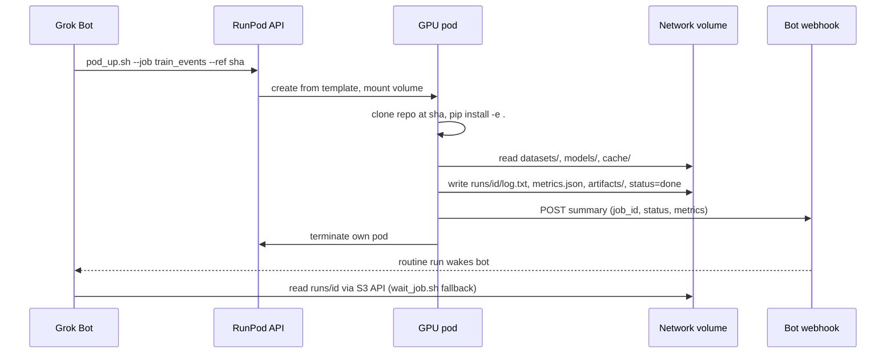
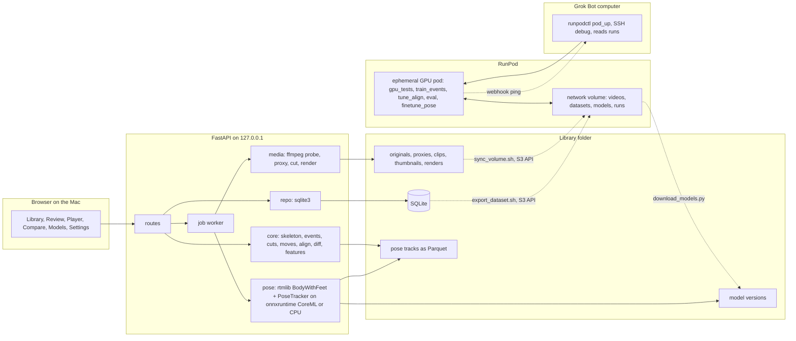
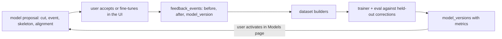

# Climbing Coach App — Build Plan

## Decisions already made
- Delivery v1: local server + browser. A launcher starts FastAPI on `127.0.0.1` and opens the browser. A native window (pywebview/WKWebView) and a double-click `.app` come in Phase 5.
- Pose model: RTMPose Halpe26 (26 keypoints incl. feet) via `rtmlib` (`BodyWithFeet` + `PoseTracker`, YOLOX person detector) on ONNX Runtime, CoreML EP on the Mac, CPU fallback. Pose-model fine-tuning is deferred to Phase 6; the learning loop first retrains our own small models.
- The "RL loop" is implemented as human-in-the-loop supervised learning: every correction (cut, event label, keypoint edit, alignment anchor) is logged with the model version that produced the proposal and becomes training data.

## Workflow: bot builds, RunPod verifies and trains, Mac runs
- A Grok Bot writes the code in a private GitHub repo (`climbing_coach`). Its cloud computer is Debian Linux x86_64, CPU only, no CoreML, no sample videos, outbound internet open, no inbound API (a routine webhook is the only way to wake it). You clone the repo to `~/dev/climbing_coach/` on the Mac, run `scripts/setup_mac.sh`, and do the deployment and the final testing there. Findings go back to the bot as GitHub issues or chat instructions; the bot never needs the Mac.
- Three execution tiers:
  - Bot computer: `pytest` with fake estimator and fake ffmpeg, `npm run build`, `ruff`/`mypy`, plus GitHub Actions on `ubuntu-latest` and `macos-latest`. Tests here must not need ffmpeg, weights, CoreML or real videos (ffmpeg tests skip when the binary is absent).
  - RunPod GPU pod (driven by the bot): full integration on Linux with CUDA. Real ffmpeg and HEVC, `onnxruntime-gpu` with `CUDAExecutionProvider`, pose on the real videos stored on the network volume, Phase 2/3 precision-recall on labelled footage, Phase 4 training, Phase 6 fine-tuning. This is where most of the "bot builds blind" risk is removed.
  - Mac (you): CoreML fps per `CC_POSE_MODE`, Safari and Chrome playback sync, Liquid Glass visual check, pywebview window, `.app` packaging. `README.md` carries a short per-phase checklist.
- The RunPod tier is specified in the RunPod section below.
- Code consequences:
  - ONNX Runtime providers are chosen at runtime in order `CUDAExecutionProvider`, `CoreMLExecutionProvider`, `CPUExecutionProvider`; `CC_DEVICE` can force one. The Mac installs `onnxruntime`, the GPU image installs `onnxruntime-gpu`; both from the same `requirements.txt` via an environment marker or a `requirements-gpu.txt` overlay.
  - Nothing Mac-specific (pywebview, PyInstaller) is imported at module top level; Phase 5 code sits behind the launcher script.
  - Tests are tiered with pytest markers: default (no external deps), `ffmpeg`, `gpu`, `videos` (needs `/workspace/videos`). The `gpu_tests` job runs all tiers.
  - Model weights, videos and the library folder are never committed (`.gitignore`); `scripts/download_models.py` fetches base weights on the Mac into `CC_MODELS_DIR` and on the pod into `/workspace/models/`.

## RunPod

### Decision: Pods, not Serverless
- Pods: a GPU container you own while it runs; arbitrary start command, SSH, hours-long processes, network volume at `/workspace`, billed per minute including idle, started and stopped by you or by the job itself.
- Serverless: HTTPS endpoint with `handler(job)` workers, scale-to-zero, per-second billing, cold starts, execution timeout to raise for long jobs, no shell and no SSH into a worker. Built for inference.
- Our jobs are batch and long (full pytest with ffmpeg and real videos, event-detector training, MMPose fine-tuning) and the bot must debug interactively over SSH. Pods fit; serverless would need a handler wrapper and timeout tuning for every job and gives nothing extra once the pod self-terminates.
- Serverless stays a future option: a pose-inference endpoint on the same image for very long videos or batch re-processing, called from the app's job worker (Phase 4+, optional, not planned now).

### Account setup (you, before Phase 0 ends)
- Dedicated RunPod account for this project, with a spending limit and low-balance alerts.
- API key (`RUNPOD_API_KEY`), S3 API key (`rps_...`, shown once) and the SSH public key from the bot computer registered under Credentials.
- One Secure Cloud network volume (network volumes exist only in Secure Cloud) in a large datacenter with good RTX 4090, A40 and A100 availability; S3 API enabled; start at 100 GB (can grow, cannot shrink).
- Upload the first sample and labelled videos with `scripts/sync_volume.sh` from the Mac.

### Network volume layout (`/workspace`)
- `videos/` — sample footage and `videos/labels/` (your start/fall/top labels for precision-recall)
- `datasets/` — COCO exports and feedback datasets from `export_dataset.sh`
- `models/` — base ONNX weights (downloaded once by `download_models.py`) and fine-tuned outputs per version
- `runs/<job_id>/` — `status`, `log.txt`, `metrics.json`, `artifacts/`
- `cache/` — pip, Hugging Face, MMPose checkpoints, so repeated jobs do not re-download

### GPU image and template
- Image `ghcr.io/<you>/climbing-coach-gpu` from `docker/gpu/Dockerfile`: CUDA 12.x runtime, PyTorch, MMPose + MMCV, `onnxruntime-gpu`, ffmpeg, repo Python deps, openssh-server. Built and pushed by `.github/workflows/gpu-image.yml` on changes to `docker/gpu/` or `requirements*.txt`; tagged with the git sha and `latest`.
- `docker/gpu/entrypoint.sh`: start sshd; if `CC_JOB` is set run `scripts/gpu/run_job.sh`, else `sleep infinity` for interactive use.
- RunPod template: the GHCR image, container disk 20 GB, network volume mounted at `/workspace`, TCP port 22 exposed, env `CC_JOB`, `CC_GIT_REF`, `CC_JOB_ID`, `CC_WEBHOOK_URL`, `RUNPOD_API_KEY`, `CC_MODELS_DIR=/workspace/models`, `CC_LIBRARY_DIR=/workspace/library`.

### Pod settings per job
- Cloud: Secure Cloud always (needed for the volume). On-Demand for `train_events`, `tune_align`, `eval`, `finetune_pose`. Spot/interruptible allowed for `gpu_tests` and `pose_bench`, where a restart is cheap.
- GPU: `pod_up.sh` takes an ordered preference list; default `RTX 4090` then `A40` then `RTX A5000` for tests and the small Phase 4 models; `A40` then `A100 80GB` for `finetune_pose`.
- Interactive pods get a hard `--ttl` (default 2 h); job pods terminate themselves.

### Job flow

- `scripts/gpu/pod_up.sh --job <name> --ref <sha> [--gpu ...] [--interactive] [--spot]` wraps `runpodctl pod create --image ... --network-volume-id ... --gpu-id ... --env ...` and prints the pod id and job id.
- `scripts/gpu/run_job.sh`: clone at `CC_GIT_REF`, resolve the job through `ml/jobs.py`, run it with output tee'd to `runs/<id>/log.txt`, write `metrics.json` and `status`, POST to `CC_WEBHOOK_URL`, then call the RunPod API to terminate the pod. Any failure still writes `status=failed` and pings the webhook before terminating.
- `scripts/gpu/wait_job.sh <job_id>` polls `runs/<id>/status` through the S3 API; `pod_down.sh <pod_id>` terminates an interactive pod.
- Jobs (`ml/jobs.py`): `gpu_tests` (all pytest tiers), `pose_bench` (fps per `CC_POSE_MODE` on CUDA), `train_events`, `tune_align`, `eval`, `finetune_pose`.
- Interactive debugging: `pod_up.sh --interactive`, then `ssh <pod>@ssh.runpod.io -i ~/.ssh/id_ed25519` (proxied SSH; no SCP, files move through the volume), then `pod_down.sh`.

### Data path between Mac and volume
- `scripts/sync_volume.sh` and `scripts/export_dataset.sh` on the Mac use `aws s3 cp --region <DC> --endpoint-url https://s3api-<DC>.runpod.io/ s3://<volume_id>/...` with the S3 API key (access key = RunPod user id, secret = `rps_...`) to upload videos, labels and COCO exports and to pull `models/` and `runs/` back.
- `download_models.py --from-volume <run_id>` copies a trained ONNX plus `metrics.json` into the Mac registry as a new `model_versions` row.
- The bot never handles videos directly; it reads `runs/` and `metrics.json`.

### Credentials and cost rules (also written into `AGENTS.md` for the bot)
- On the bot computer: `RUNPOD_API_KEY`, the S3 API key, and the SSH key. They are visible to every Bot on the account, so the RunPod account holds only this project. No cloud-provider root credentials and no GitHub admin tokens live there.
- The bot must run `pod_down.sh` at the end of every interactive session and must never start a pod without `--ttl` or a `CC_JOB`.
- The spending limit is the backstop; the volume bills continuously but is small.

## Assumptions (stated, not asked)
- Single user, no login. Backend binds `127.0.0.1` only.
- Primary video source: files recorded on a phone and imported (AirDrop, Files). MOV/MP4, HEVC or H.264, any orientation. In-app webcam recording (`getUserMedia`) is optional and later.
- Camera is fixed within one video. Two videos of the same boulder may have different camera positions; comparison uses body-relative normalization, and the overlay can use user-marked reference holds.
- Runtime target is one Apple Silicon Mac: Python 3.11+ (Homebrew or python.org) in a venv, Node 20+ (Homebrew), ffmpeg from Homebrew. No Docker for the app (it is a standalone Mac app); the only Docker image is the GPU image for RunPod (integration tests, training, Phase 6 fine-tuning), which never runs on the Mac.
- You have a RunPod account with an API key, an S3 API key, a registered SSH public key, a spending limit, and one network volume created in the chosen datacenter before Phase 0 ends. Sample and labelled videos are uploaded to the volume by you.
- Library data lives in `~/Library/Application Support/ClimbingCoach/` (HIG location) or a user-chosen folder, with `library/` (SQLite, originals, proxies, clips, thumbnails, renders, Parquet tracks) and `models/` (ONNX weights, registry) under it. Nothing persistent is written inside the repo. `AGENTS.md` records these paths as the project data location.
- Python 3.11+ (onnxruntime 1.31 requires >= 3.11), macOS 13.3+ in practice (onnxruntime wheel), Apple Silicon only.
- Dev ports: backend 8810, Vite 8811 (confirm free at setup). Versions are pinned in `requirements.txt` / `package.json` at setup time after checking.
- Project docs are written in ASD-STE100; this plan is not.

## Project location and layout
GitHub repo `climbing_coach` (private), cloned to `~/dev/climbing_coach/` on the Mac
- `.github/workflows/ci.yml` — pytest + npm build on ubuntu and macos runners; `gpu-image.yml` — build and push `docker/gpu/Dockerfile` to GHCR; `.gitignore` for venv, node_modules, weights, library data
- `docker/gpu/` — `Dockerfile`, `entrypoint.sh` (sshd, then `run_job.sh` if `CC_JOB` is set, else idle)
- Docs: `AGENTS.md`, `README.md`, `ARCHITECTURE.md`, `DATA_MODEL.md`, `TROUBLESHOOTING_LOG.md`, `DLOG.md`, `errors/`
- `backend/app/`
  - `config.py` — frozen `Settings` from env: `CC_LIBRARY_DIR`, `CC_MODELS_DIR`, `CC_FFMPEG_BIN`, `CC_PORT`, `CC_POSE_MODE` (lightweight/balanced/performance), `CC_DEVICE`
  - `main.py` — app, `/health`, static frontend, job worker start
  - `db.py`, `repo.py` — stdlib `sqlite3`, WAL mode, `schema_migrations` table
  - `jobs.py` — in-process job queue (worker thread, SQLite `jobs` table, progress polling); no Celery/Redis
  - `routes/` — `library.py`, `videos.py`, `attempts.py`, `pose.py`, `compare.py`, `feedback.py`, `models.py`, `jobs.py`
  - `media/` — `ffmpeg.py` (probe, proxy transcode, frame-accurate cut, thumbnails, render), `frames.py` (frame iterator with rotation handling)
  - `pose/` — `estimator.py` (`PoseEstimator` protocol; `RtmlibEstimator` with explicit local ONNX paths from `CC_MODELS_DIR`, never the default `~/.cache`), `climber.py` (climber selection and track continuity)
  - `core/` — pure functions, no HTTP/SQL/file IO, tested with synthetic sequences; this is the part that gets ported to Swift later: `skeleton.py` (Halpe26 schema, edges, hip-center + torso-scale normalization, joint angles), `events.py` (start/end detectors, outcome), `cuts.py` (proposal with pre/post roll), `moves.py` (move segmentation), `align.py` (DTW with band and anchors), `diff.py` (posture differences), `features.py` (attempt features for analytics)
  - `render/overlay.py` — server-side skeleton drawing, side-by-side and blend composer for exports
- `backend/tests/` — pytest
- `frontend/` — Vite + React 19 + react-router; the bot writes its own small Liquid Glass theme from the Apple guidelines: `src/theme/liquid-glass/tokens.css` (`--lg-*` colour, radius, blur, spring tokens), `glass.css` (glass surfaces, capsules, concentric radii, reduced-transparency and reduced-motion fallbacks), `src/components/glass.jsx` (GlassBar, GlassPanel, GlassButton, Segmented, Sheet, Slider); `app.css` only uses `--lg-*` tokens; `frontend/DESIGN_GUIDELINES.md` records the rules the theme follows
- `ml/` — `datasets/` (builders), `train/` (event detector, alignment tuning, eval), `registry/` (version manifests), `finetune_pose/` (Phase 6, MMPose config and ONNX export), `jobs.py` (job registry: name to entrypoint, used by `run_job.sh`)
- `scripts/` — `setup_mac.sh` (brew deps, venv, pip, npm, model download, library folder), `dev.sh`, `run_mac.sh`, `build.sh`, `download_models.py`, `export_dataset.sh`, `sync_volume.sh`, `package_mac.sh` (Phase 5)
- `scripts/gpu/` — `pod_up.sh` (runpodctl create with image, volume, GPU type, env), `run_job.sh` (clone at ref, run job, write run folder, webhook ping, self-terminate), `pod_down.sh`, `wait_job.sh` (poll `runs/<job_id>/status` through the S3 API)

## Architecture

Learning loop:

## Data model (SQLite + files; detailed in `DATA_MODEL.md`)
- `boulders` (name, gym, grade, hold colour, sector, set date, status, notes)
- `sessions` (date, gym, notes)
- `videos` (boulder, session, original path, proxy path, sha256, duration, fps, size, rotation, recorded_at, status)
- `pose_tracks` (video, model_version, Parquet path, fps, n_frames, climber track id, status); Parquet columns `frame, track_id, kpt, x, y, score` plus a bbox table
- `pose_edits` (track, frame, kpt, x, y, kind: move / lr_swap / track_reassign / mark_bad) — deltas, raw inference is never overwritten
- `scene_marks` (video, kind: floor_line / top_zone / start_holds / ref_points, geometry JSON, source auto/user)
- `events` (video, frame, kind: leave_ground / start / fall / top / ground_return, source, confidence, model_version)
- `attempts` (video, boulder, proposed start/end frame, final start/end frame, outcome send/fall/unknown, clip path, proximity 0-10, exertion 0-10, notes)
- `comparisons` (attempt A, attempt B, warp path file, params, render path) and `alignment_anchors` (frame A, frame B, source)
- `feedback_events` (kind, entity, before JSON, after JSON, model_version) — the unified correction log
- `model_versions` (family pose / event / align, version, path, metrics JSON, dataset hash, active)
- `jobs`, `schema_migrations`

## How each requirement is met
- Start detection (v1 rules in `core/events.py`): floor line estimated from ankle positions in pre-climb standing frames (user can adjust once per video); start = first frame where both feet are above the floor line for >= 0.5 s. Top zone drawn once per boulder.
- Fall / end detection: fast downward hip velocity (normalized by body height) followed by feet back at floor level. Outcome: if hips or hands reached the top zone before the descent, "send", else "fall"; the user confirms. A controlled jump-off looks like a fall, so the top zone plus confirmation is required until the trained detector takes over.
- Auto-cut: proposals = [start - pre-roll, end + post-roll]; review UI shows proposals over the full-video timeline with in/out handles and frame stepping; accept, adjust, reject, batch accept. Accepted cuts call ffmpeg (re-encode for frame accuracy); the clip's pose track is a slice of the parent track, no re-run.
- Skeleton view: `<canvas>` over `<video>` synced with `requestVideoFrameCallback`; overlay mode and skeleton-only mode; server-side render for MP4 export. Imported videos get an H.264 proxy so HEVC from iPhone plays in every browser and pose runs on a downscaled copy.
- Climber selection: all persons are tracked; default = the track with the largest vertical travel inside the wall region; the user can click the climber in a frame to fix it (logged as feedback).
- Comparison of two attempts: body-relative normalization (hip centre, torso scale); optional similarity transform from 2-4 user-marked reference holds for overlay; side-by-side and blended overlay; movement-matched scrubbing (master timeline drives the other video through the warping path); rendered comparison MP4 for smooth playback and sharing.
- Pacing (match movement, not time): DTW in `core/align.py` on per-frame features (normalized joints, joint angles, velocities) with a Sakoe-Chiba band; user anchors constrain the path; move segmentation in `core/moves.py` (a hand or foot goes static -> moving -> static at a new place = one move) gives move-level stats such as rest time per hold and number of moves.
- Posture differences: per aligned frame pair, joint-angle and limb-position deltas; joints above a threshold are heat-coloured on the skeleton; a difference strip under the timeline and a ranked list ("left knee angle differs 32 deg at move 4").
- Ratings: two sliders (proximity to success, exertion) plus outcome and notes on each attempt; `core/features.py` turns a track into an attempt feature vector; the Models page correlates features with ratings and outcome over time (Phase 4).
- Fine-tune UIs that feed the loop: skeleton editor (drag keypoints with interpolation to neighbours, swap left/right, reassign track, mark frame bad), cut editor, event labels, alignment anchors, scene marks.
- Learning loop v1 (`ml/`): dataset builders from `feedback_events`; event-detector trainer (per-frame features -> small temporal model, GRU or 1D CNN; runs as the `train_events` job on a RunPod pod, and also on Mac CPU/MPS for small datasets from the Models page), evaluation against held-out corrections (boundary MAE in frames, attempt precision/recall), alignment feature-weight tuning from anchors (`tune_align` job); registry + activation in the UI; `download_models.py --from-volume` imports a pod-trained version.
- Phase 6: corrected keypoints exported as COCO JSON with `export_dataset.sh` to `/workspace/datasets/`; RTMPose-m Halpe26 fine-tuned with MMPose as the `finetune_pose` job in the GPU image; ONNX export lands in `/workspace/models/` and the Mac pulls it into the registry.

## UI (HIG + Liquid Glass)
- Follows [Human Interface Guidelines](https://developer.apple.com/design/human-interface-guidelines) and [Liquid Glass](https://developer.apple.com/documentation/technologyoverviews/liquid-glass). The bot writes a small CSS theme and component set from these guidelines (no external kit) and records the rules in `frontend/DESIGN_GUIDELINES.md`: glass only on the top bar, controls, menus and sheets; video, timelines and tables on the calm content layer; one blue primary action per view; capsules and concentric radii; one spring curve; system font stack (`-apple-system`); `prefers-reduced-transparency`, `prefers-contrast` and `prefers-reduced-motion` honoured; dark and light token sets from `prefers-color-scheme`.
- macOS layout: glass top bar with segmented view switch (Library / Compare / Models / Settings); three-column pages (sidebar list, content, inspector). Keyboard: space, left/right frame step, J/K/L, I/O in and out points, Enter accepts a proposal. Drag-and-drop import. Progress for long jobs in the inspector.
- Known limits: CSS can only emulate Liquid Glass (`backdrop-filter`, layered borders and highlights); the real material arrives with the native iOS app. Visual review happens on the Mac in Safari and Chrome; the bot cannot see the result, so the README includes a short visual checklist.

## Phases
Each phase has three validation steps: "bot" (bot computer and CI, must be green before anything goes to a pod), "pod" (the bot launches a RunPod job and reads the run folder; must be green before handover) and "Mac" (you run it after `git pull`, following the README checklist, and report back).
- Phase 0 — Docs and skeleton: `AGENTS.md` presented for review before any code, then `README.md` (Mac setup, RunPod setup, per-phase checklists), `ARCHITECTURE.md` with the diagram, `DATA_MODEL.md`, logs, `errors/`; repo layout, `.gitignore`, CI and GPU image workflows, config layer, SQLite migrations, `/health`, Liquid Glass theme, empty shell UI, `setup_mac.sh`, `scripts/gpu/`, model download. Bot: `pytest`, `npm run build`, `curl /health`, GHCR image builds. Pod: `pod_up.sh --job gpu_tests` on an empty volume runs the suite with real ffmpeg and `CUDAExecutionProvider`, writes `runs/<id>/metrics.json`, pings the webhook, terminates itself. Mac: `setup_mac.sh` on a clean clone, `run_mac.sh` opens the shell UI, `sync_volume.sh` uploads the first sample videos.
- Phase 1 — Library, import, pose, playback, manual cut, ratings. Bot: fake estimator and fake ffmpeg tests; CI green. Pod: `gpu_tests` with the `videos` tier (import HEVC, proxy, pose on the sample videos), `pose_bench` records fps per `CC_POSE_MODE` on CUDA. Mac: fps per `CC_POSE_MODE` on CoreML and CPU, overlay sync in Safari and Chrome, manual cuts.
- Phase 2 — Auto start/fall detection and auto-cut review with feedback logging. Bot: synthetic sequence tests. Pod: precision/recall on the labelled videos in `/workspace/videos/labels/`. Mac: review UI on real footage; corrections appear in `feedback_events`.
- Phase 3 — Comparison: normalization, move segmentation, DTW with anchors, Compare page, posture differences, rendered export. Bot: DTW tests (identity and time-stretched copies give monotone paths), golden tests. Pod: compare pipeline and rendered MP4 on two real attempts, timing. Mac: Compare page scrubbing and playback.
- Phase 4 — Learning loop v1 and progress analytics. Bot: trainer and eval on a synthetic feedback set. Pod: `train_events`, `tune_align` and `eval` on the exported feedback dataset; metrics in the run folder. Mac: import the trained version with `download_models.py --from-volume`, activate it in the Models page, check analytics.
- Phase 5 — Mac polish and packaging: `run_mac.sh` launcher, Settings page, pywebview window, PyInstaller `.app`, HIG and accessibility check, performance. Bot: build script and spec files only (cannot run them). Pod: not applicable. Mac: `package_mac.sh` produces a working `.app`; accessibility and performance checks.
- Phase 6 — Pose-model fine-tuning as the `finetune_pose` job on RunPod (MMPose in the GPU image, A40/A100 class GPU) with ONNX export to the volume and A/B evaluation in the app on the Mac.
- Phase 7 (future) — iOS: Swift app that shares the library format and the `core/` behaviour (tests as the spec), CoreML conversion; Android after.

## Risks
- Fall vs controlled jump-off is ambiguous for rules; mitigated by the top zone and user confirmation, then by the trained detector.
- Spotters and bystanders: climber selection and track continuity on occlusion need real footage early.
- Smooth movement-matched playback in a browser is seek-limited; scrubbing is interactive, smooth playback uses the rendered MP4.
- `rtmlib` downloads weights to a home cache by default; the estimator must receive explicit paths under `CC_MODELS_DIR`.
- ffmpeg comes from Homebrew during development; the packaged `.app` (Phase 5) must bundle a static binary so it does not depend on Homebrew; the path is configurable through `CC_FFMPEG_BIN`.
- RunPod cost: a pod left running idles at full price. `run_job.sh` always self-terminates, `pod_up.sh --interactive` sets a hard `--ttl` and the bot's `AGENTS.md` instructs it to run `pod_down.sh` at the end of every session; a RunPod spending limit is the backstop. The network volume bills continuously but is small.
- RunPod availability: a network volume pins pods to one datacenter; if that datacenter runs out of the wanted GPU the job waits. `pod_up.sh` accepts a list of acceptable GPU types (4090 first, then A40, A5000) and the volume is created in a large datacenter.
- Shared credentials: the RunPod API key, the S3 API key (needed to read run folders after a pod has terminated) and the SSH key on the bot computer are visible to every Bot on the account. The RunPod account is dedicated to this project, holds no other data, and has a spending limit; keys are rotated if a Bot is removed from the roster.
- Webhook completion ping is fire-and-forget (200 means the bot run started, not finished); `wait_job.sh` polling through the S3 API or SSH is the fallback when the ping is missed.
- The bot never runs on macOS: CoreML, pywebview, PyInstaller, Safari playback and the Liquid Glass look are only verified on your Mac. Everything else is verified on the pod first. Mitigated further by the macos CI runner, provider selection at runtime, strict separation of Mac-only code, and the per-phase README checklists.
- Pinned versions chosen in the Linux sandbox may lack Apple Silicon wheels (for example a too-new `onnxruntime` or `pyarrow`); the macos CI job catches this before you clone.
- A Liquid Glass look written blind from the guidelines may need visual tuning; the token-only `app.css` keeps that tuning confined to `tokens.css` and `glass.css`.
