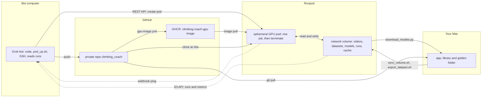
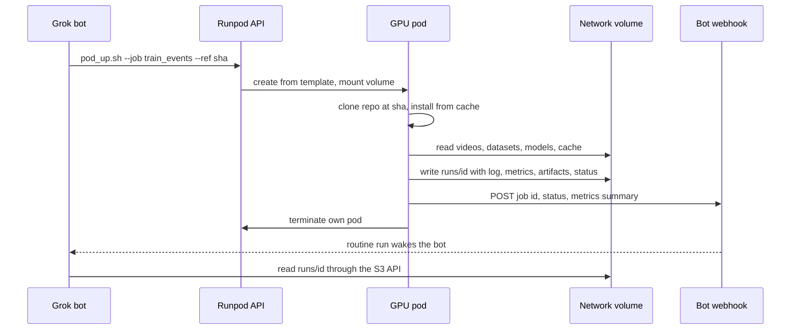
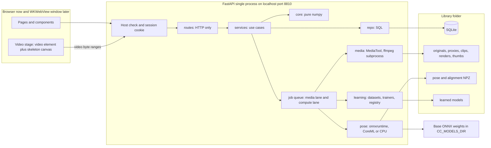
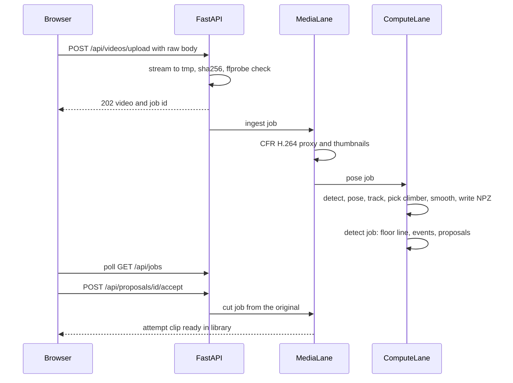
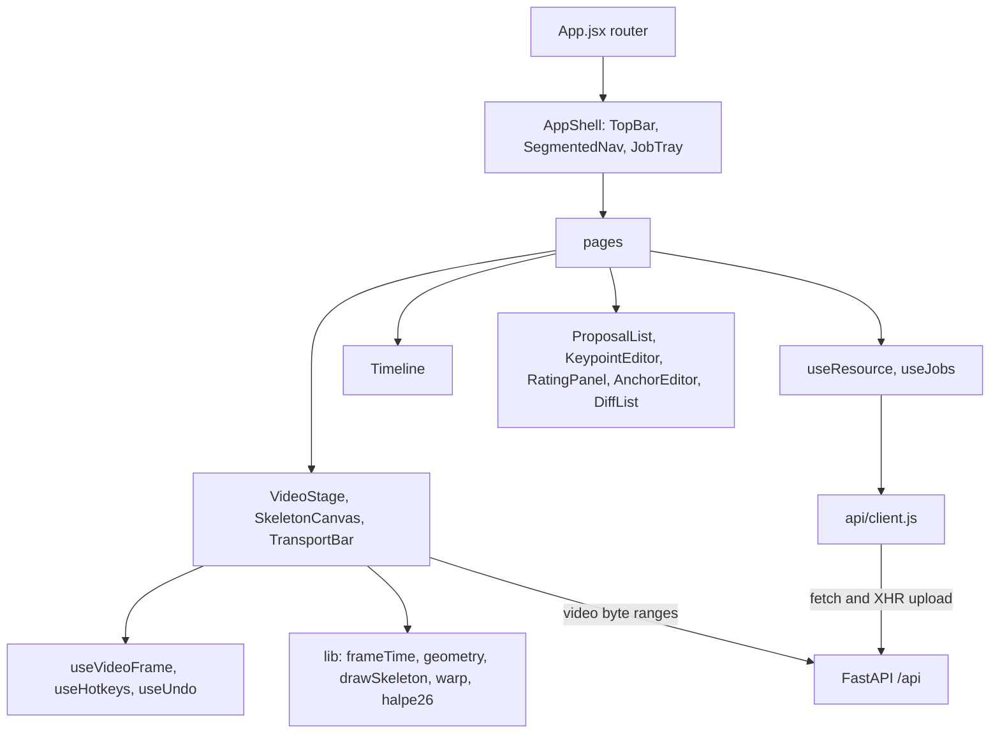
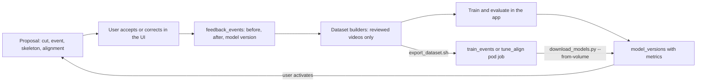

# Climbing Coach — Detailed Coding Plan

This plan replaces the first build plan. Grok bot (the builder) writes the code in a private GitHub repo and runs GPU, real-footage and training jobs on Runpod pods. You clone the repo to an Apple Silicon Mac and run and test it there. Where the first plan says otherwise (Node 20, Homebrew ffmpeg on every macOS version, Python 3.11, onnxruntime 1.31, rtmlib `PoseTracker`, Parquet tracks, a GRU or 1D-CNN event model, MMPose in the Phase 0 GPU image, the account API key in the pod template), follow this plan.

## 1. Build and test workflow

- Repo: a private GitHub repo `climbing_coach`, cloned on the Mac to `~/dev/climbing_coach/`.
- Builder: Grok bot. Its computer is Debian Linux x86_64 with CPU only: no CoreML, no VideoToolbox, no Safari, no model weights and no sample videos. Outbound internet is open. There is no inbound API; a routine webhook is the only way to wake the bot.
- Three tiers verify the work:
  - Bot computer and CI: lint, build and the portable tests with fakes. They must be green before anything goes to a pod.
  - Runpod GPU pods (section 2), started by the bot: Linux with CUDA, real ffmpeg and HEVC, `onnxruntime-gpu`, pose and metrics on your labelled footage, Phase 4 training and Phase 6 fine-tuning. This tier removes most of the risk of building blind.
  - Your Mac: CoreML speed and parity, VideoToolbox, Safari playback and sync, the Liquid Glass look, the pywebview window and the `.app`.
- Rules for the code
  - Everything the bot computer can verify runs on Linux CPU. A test that needs ffmpeg, model weights, CUDA, macOS hardware or real footage carries a marker and skips with a reason when that need is missing (section 11).
  - Fakes keep the API testable without ffmpeg or models: `FakeMediaTool` behind the `MediaTool` protocol, and `FixtureEstimator` behind `PoseEstimator`.
  - ONNX Runtime providers are chosen at run time in the order CUDA, CoreML, CPU; `CC_DEVICE` can force one. The Mac and CI install `onnxruntime`; pods install `onnxruntime-gpu` of the same version from `requirements-gpu.txt`.
  - Mac-only code (pywebview, PyInstaller, `open -R`) lives in `launcher/` or behind a `sys.platform == "darwin"` check. `backend/app` never imports it at module level.
  - Never commit model weights, videos, library folders, `.venv`, `node_modules` or `frontend/dist`.
- CI (GitHub Actions, on every push and pull request): an `ubuntu-24.04` job and a `macos-15` (Apple Silicon) job (section 11 lists what each runs), plus `gpu-image.yml`, which builds the pod images. The macOS job proves that every pinned wheel installs on Apple Silicon before you clone.
- Mac pass (you, after `git pull`): run `scripts/setup_mac.sh` once, then `scripts/check.sh --all`, `pytest -m golden` on your own footage, and the phase checklist in `README.md` (visual, Safari, performance). Report the results to the bot as GitHub issues, with the logs attached.
- A phase is handed over when CI and its pod checks are green, and it is done when your Mac pass is green too.
- Your videos go only to the project's Runpod network volume, uploaded by you. The bot works with run folders and metrics, never with footage (section 2.7).

## 2. Runpod GPU tier



### 2.1 Pods, not Serverless
- Pods: a GPU container that runs as long as needed, with any start command, SSH, and the network volume at `/workspace`. A pod bills for as long as it exists, idle time included, so job pods terminate themselves.
- Serverless: an HTTPS endpoint with `handler(job)` workers, scale to zero, cold starts, execution timeouts, and no shell or SSH into a worker. It is built for inference.
- Our jobs are long batch runs (the full test suite with ffmpeg and real videos, training, fine-tuning), and the bot must debug over SSH. Pods fit. Serverless would need a handler wrapper and timeout tuning for every job, and gives nothing extra once job pods terminate themselves.
- Serverless stays a later option: a pose-inference endpoint on the same image for batch re-processing of long videos (not planned).

### 2.2 Account setup (you, before Phase 0 ends)
- A Runpod account used only for this project, with a spending limit and low-balance alerts.
- Credentials for the bot computer: an API key; an S3 API key (the access key is your `user_...` id; the `rps_...` secret is shown only once); and the bot computer's SSH public key, added to the account.
- A container registry credential in Runpod: a GitHub token with only `read:packages`, so pods can pull the private GHCR image.
- Two Runpod secrets, which the pod template references as `{{ RUNPOD_SECRET_<name> }}`: `cc_repo_token` (a fine-grained GitHub token with read-only access to this repo's contents, for the clone inside the pod) and `cc_webhook_url` (the bot's routine webhook; anyone who has the URL can wake the bot).
- One network volume, 100 GB to start (it can grow but not shrink). Network volumes exist only in Secure Cloud. Create it in a datacenter that supports the S3 API (for example `EU-RO-1`, `EUR-IS-1`, `US-KS-2` or `US-CA-2`; the full list is in the Runpod S3 API docs) and has good availability of NVIDIA L4, RTX 2000 Ada, RTX 4090, A100 80GB PCIe, RTX PRO 4500/4000 Blackwell, and GeForce RTX 5090. This project's volume is in `EU-RO-1`.

### 2.3 Network volume layout (`/workspace`)
- `videos/`: your golden footage, a copy of the Mac golden folder, with `videos/labels/labels.json` and `videos/manifest.json`.
- `datasets/<name>/`: feedback datasets (Phase 4) and COCO exports (Phase 6), uploaded by `export_dataset.sh`.
- `models/`: base ONNX weights (downloaded once by `download_models.py`) and trained outputs per family and version.
- `runs/<job_id>/`: `status`, `log.txt`, `metrics.json`, `artifacts/`.
- `cache/`: pip and checkpoint downloads, so repeated jobs do not download them again.
- Each job imports into a fresh scratch library on the container disk, so runs at different commits never share a database. Jobs write only to `runs/`, `models/` and `cache/`.

### 2.4 GPU images and pod template
- `climbing-coach-gpu` (from Phase 0), built from `docker/gpu/Dockerfile`: an `nvidia/cuda` 12.x runtime image with cuDNN 9 on Ubuntu 24.04 (its system Python is 3.12); `onnxruntime-gpu==1.23.2` (CUDA 12, cuDNN 9); the repo's pins from `requirements-gpu.txt`; the same pinned static ffmpeg 7 build as CI; `openssh-server`, `git`, `curl`, `jq`. No PyTorch. `.github/workflows/gpu-image.yml` builds it and pushes it to GHCR when `docker/gpu/` or `requirements*.txt` change, tagged with the git sha and `latest`.
- `climbing-coach-train` (Phase 6), built from `docker/train/Dockerfile`: PyTorch, MMCV 2.2 and MMPose 1.3 with NumPy 1.26. It is a separate image because MMCV and MMPose do not work with NumPy 2, and the app pins NumPy 2.5.
- `entrypoint.sh` (both images): write `$PUBLIC_KEY` (which Runpod injects) to `~/.ssh/authorized_keys`; generate SSH host keys at start-up if they are missing; start sshd on every pod; start a watchdog that terminates the pod after `CC_TTL_S`; if `CC_JOB` is set, run `scripts/gpu/run_job.sh`, else wait for SSH sessions. Do not generate host keys at image build time.
- Pod template: the GHCR image with the registry credential; a 20 GB container disk; the network volume at `/workspace`; port `22/tcp`; env `CC_JOB`, `CC_GIT_REF`, `CC_JOB_ID`, `CC_TTL_S`, `CC_MODELS_DIR=/workspace/models`, `CC_GOLDEN_DIR=/workspace/videos`, `CC_REPO_TOKEN={{ RUNPOD_SECRET_cc_repo_token }}`, `CC_WEBHOOK_URL={{ RUNPOD_SECRET_cc_webhook_url }}`.
- The account API key never goes into a pod. A job pod terminates itself with the pod-scoped `RUNPOD_API_KEY` and the `RUNPOD_POD_ID` that Runpod injects.

### 2.5 Pod settings per job
- Secure Cloud always (the volume needs it). On-Demand for `eval`, `train_events`, `tune_align` and `finetune_pose`. Interruptible (spot) is allowed for `gpu_tests` and `pose_bench`, where a restart is cheap.
- GPU preference lists (`gpuTypeIds` with `gpuTypePriority: "custom"`): `NVIDIA L4`, `NVIDIA RTX 2000 Ada Generation`, `NVIDIA GeForce RTX 4090`, `NVIDIA A100 80GB PCIe`. Keep `NVIDIA RTX PRO 4500 Blackwell`, `NVIDIA RTX PRO 4000 Blackwell`, and `NVIDIA GeForce RTX 5090` off the default list until a pod shows `CUDAExecutionProvider` working under ONNX Runtime on sm_120. These types are available in `EU-RO-1`.
- `CC_TTL_S` is the backstop if `run_job.sh` hangs: 2 h for interactive pods, and a limit per job type for job pods (for example 1 h for `gpu_tests` and 12 h for `finetune_pose`).

### 2.6 Job flow



- Pods run only pushed commits: the bot pushes first, then starts the pod with that sha.
- `scripts/gpu/pod_up.sh --job <name> --ref <sha> [--gpu ...] [--spot] [--ttl ...]`, or `--interactive`, calls `POST https://rest.runpod.io/v1/pods` (template, volume, GPU list, `interruptible`, job env) and prints the pod id and job id. `runpodctl pod ...` stays available for manual use.
- `scripts/gpu/run_job.sh` (inside the pod): clone at `CC_GIT_REF`; install from `requirements-gpu.txt` with `/workspace/cache/pip` (a no-op when the image is current); run the job from `ml/jobs.py`, with output copied to `runs/<id>/log.txt`; write `metrics.json` and `status`; POST a summary to `CC_WEBHOOK_URL`; terminate the pod (`DELETE https://rest.runpod.io/v1/pods/$RUNPOD_POD_ID`). A shell `trap` makes sure that a failure still writes `status=failed`, pings and terminates.
- `wait_job.sh <job_id> [--pod-id <pod_id>]` polls `runs/<id>/status` through the S3 API (the fallback when a ping is missed). `--pod-id` fails early if the pod exits before status is `passed`. `pod_down.sh <pod_id>` terminates a pod; `pod_ls.sh` lists pods and their age.
- Jobs (`ml/jobs.py`): `gpu_tests` (every pytest tier that Linux supports), `pose_bench` (frames per second per pose mode on CUDA, and CUDA vs CPU keypoint parity), `eval` (event, cut and climber metrics of a rule set or model version on the golden footage), `train_events`, `tune_align`, `finetune_pose`.
- Interactive debugging: `pod_up.sh --interactive`, then `ssh <pod>@ssh.runpod.io -i ~/.ssh/climbing_coach_ed25519` (Runpod's SSH proxy; it has no SCP, so files move through the volume), then `pod_down.sh`.

### 2.7 Data path between the Mac and the volume
- `scripts/sync_volume.sh` (Mac) runs `export_labels.py`, then copies new golden videos and `labels.json` to `videos/` with `aws s3 cp --region <DC> --endpoint-url https://s3api-<dc>.runpod.io/ s3://<volume_id>/...`. It copies file by file and skips files already listed in `videos/manifest.json`, because `aws s3 sync` is unreliable on Runpod's S3 API for large trees. Each file goes up as one `put-object` call. Runpod's S3 API rejects a single upload above about 175–200 MB (HTTP 413, which the AWS CLI reports as "Connection was closed"), so `sync_volume.sh` refuses any file over 150 MiB before it calls S3. Multipart upload is not used. Before the golden-set sync, `sync_volume.sh` gains a pre-step (decided by you, 2026-10-22): a file over 150 MiB is transcoded to H.264 1080p with the same frame rate and the rotation applied (through `CC_FFMPEG_BIN` with an argument list, never a shell), and smaller files go up unchanged. The manifest records the sha256 of the original and of the uploaded file, so `labels.json` (keyed by the original's sha256) still resolves and the skip logic does not transcode again. A test proves that a proxy built from the 1080p file has the same `n_frames` and `proxy_fps` as one built from the original, ±1 frame. If a transcoded file is still over 150 MiB, the run fails before it uploads anything.
- `scripts/export_dataset.sh` (Mac) builds a feedback dataset (Phase 4) or a COCO export (Phase 6) from your library and uploads it to `datasets/<name>/`.
- `download_models.py --from-volume <run_id>` (Mac) copies a trained model and its `metrics.json` into your library as a new, inactive `model_versions` row.
- Models from the volume are untrusted input. They are ONNX plus JSON only, never pickle or joblib. `download_models.py` refuses any other file type and checks each file's sha256 against `metrics.json`.
- Run folders hold logs, metrics and model files only, never frames or clips. The S3 key on the bot computer can read the whole volume, so "the bot never handles footage" is a rule in `AGENTS.md`, not a technical barrier.
- The volume is a working copy; the originals stay on the Mac. At a $0 balance Runpod stops pods, and if storage charges stay unpaid, the volume can eventually be deleted.

### 2.8 Credentials and cost rules (also in `AGENTS.md`)
- On the bot computer: the Runpod API key, the S3 API key and the SSH key. Every bot on that computer can see them, so the Runpod account holds only this project, and no cloud root credentials or GitHub admin tokens live there. Rotate the keys when a bot is removed.
- In pods: only the pod-scoped key that Runpod injects, plus the two Runpod secrets.
- The bot never starts a pod without `CC_TTL_S` and either `CC_JOB` or `--interactive`. It runs `pod_down.sh` at the end of every interactive session, and `pod_ls.sh` at the start and end of each work session.
- The spending limit is the backstop. The volume bills continuously, but it is small.

## 3. Key technical decisions (verified 2026-10-21)

- **ONNX Runtime pin:** `onnxruntime==1.23.2`, the last release with `macosx_13_0_arm64` wheels (1.24.1 through 1.31.0 need macOS 14). Pods use `onnxruntime-gpu==1.23.2` (Python 3.12 Linux wheel, CUDA 12 and cuDNN 9). One version everywhere lets CPU, CUDA and CoreML results be compared.
- **Runpod Pods, not Serverless** (section 2.1).
- **Two GPU images:** the Phase 0 test image has no PyTorch; the MMPose trainer image comes in Phase 6 (section 2.4).
- **No pickle across the volume:** learned models are ONNX (the event classifier goes through `skl2onnx`) plus JSON parameters, wherever they are trained. The app never loads a pickle or joblib file.
- **No rtmlib `PoseTracker`:** it returns no track IDs and silently swallows detector errors. Call rtmlib `YOLOX` + `RTMPose` directly and track people ourselves. `RTMPose` falls back to the whole image when it gets zero boxes, so the wrapper skips frames with no detection.
- **rtmlib install:** 0.0.16 declares both `opencv-python` and `opencv-contrib-python`. Install it with `pip install --no-deps` and provide `opencv-python-headless==4.14.0.94` (macOS 13 arm64 wheel). Stay on OpenCV 4.x: rtmlib reads `cv2.dnn` constants at import time, and OpenCV 5 is untested with it.
- **Pose storage:** NPZ files (numpy only, easy to slice, easy to read from Swift later).
- **Mac toolchain for development and tests:** Python 3.12 (python.org installer; Homebrew also works on macOS 15+); Node 24 LTS (nodejs.org installer; needs macOS 13.5+); ffmpeg 7+ (Homebrew on macOS 15+; Homebrew builds no bottles for macOS 13 or 14, so there use a static arm64 build through `CC_FFMPEG_BIN`); AWS CLI v2 (official installer) for the volume scripts. The Phase 5 `.app` bundles Python and ffmpeg and needs no Node.
- **Playwright WebKit needs macOS 15+** (1.58 dropped macOS 13, 1.59 dropped macOS 14). On older Macs, end-to-end tests run in Chromium and Safari is checked by hand.
- **Scene marks are per video,** because the camera moves between sessions. A "copy from another video of this boulder" action covers the fixed-camera case.
- **The skeleton editor is in Phase 2** so that correction data starts accumulating early. **`videos.review_status`**: only fully reviewed videos may supply "not an attempt" labels.

## 4. Technical stack (versions checked 2026-10-21; pin exactly at setup)

Runtime: Apple Silicon, macOS 13+. Development and tests: the bot computer and CI (Linux), Runpod pods (Linux with CUDA), and your Mac.
- Python 3.12 (numpy 2.5 requires it). One uvicorn process; the job worker threads run inside it.
- `fastapi==0.156.6`, `starlette==1.8.0` (`FileResponse` serves byte ranges, which Safari needs to play and seek video), `uvicorn[standard]==0.54.0`, pydantic 2.
- `numpy==2.5.4`, `onnxruntime==1.23.2` (the macOS wheel includes the CoreML execution provider; Linux uses CPU; pods use `onnxruntime-gpu`), `rtmlib==0.0.16` (no deps) + `tqdm`, `opencv-python-headless==4.14.0.94`.
- SQLite via the stdlib `sqlite3` module in WAL mode; raw SQL in `repo/`; numbered `.sql` migrations.
- ffmpeg/ffprobe 7.0+. Encoder auto-detection runs a short test encode: `h264_videotoolbox` on the Mac, `libx264` elsewhere or when the test encode fails.
- Phase 4 adds `scikit-learn==1.9.1`, `scipy==1.18.1` and `skl2onnx==1.20.0`. At Phase 4 start, check that it converts `HistGradientBoostingClassifier` from scikit-learn 1.9; the fallback is `skops` 0.16 with a trusted-type list.

Frontend: `npm run build` writes `frontend/dist` (not committed); FastAPI serves it as static files.
- Node 24 LTS (build and tests); `vite@8.3.5` + `@vitejs/plugin-react`; `react@19.3.1`; `react-router@8.5.0` (route, link and params APIs only). Plain JSX; no UI, state or chart library.
- A Liquid Glass theme written by the bot (section 5.9): `tokens.css`, `glass.css` and `glass.jsx`, with the rules recorded in `frontend/DESIGN_GUIDELINES.md`. `app.css` holds layout only, built on the `--lg-*` tokens.
- `build.target: ["safari16", "chrome107"]` (Safari 16 is the oldest Safari on macOS 13).

GPU tier (Runpod, section 2)
- Pod image: `nvidia/cuda` 12.x + cuDNN 9 runtime on Ubuntu 24.04, Python 3.12, `onnxruntime-gpu==1.23.2`, the CI's static ffmpeg 7 build, sshd, git, curl, jq.
- Control: the Runpod REST API (`https://rest.runpod.io/v1`) through `curl` and `jq`; the volume's S3 API through AWS CLI v2 (bot computer and Mac).
- Phase 6 trainer image: PyTorch, MMCV 2.2, MMPose 1.3, NumPy 1.26 (exact pins chosen then).

Tests and tooling
- Backend: pytest, pytest-cov, httpx (for TestClient), ruff, mypy.
- Frontend: `vitest@5.0.5`, @testing-library/react, jsdom.
- End-to-end: `@playwright/test@1.64.1`. Its Chromium project runs Chrome for Testing (which plays H.264) on Linux x86_64 and on the Mac. Its WebKit project, the closest match to Safari and WKWebView, runs on macOS 15+ only.
- CI: GitHub Actions (section 11).

Later phases
- Phase 5: pywebview (WKWebView window), a PyInstaller `.app`, and an LGPL ffmpeg build that uses VideoToolbox (no GPL libx264). The bot writes these; the Mac builds and runs them.
- Phase 6: the trainer image on Runpod (section 2.4).

## 5. Architecture

### 5.1 System



### 5.2 Backend rules
- Layers: `routes` (HTTP only) call `services` (use cases; they own transactions), which call `core`, `pose`, `media`, `learning`, `repo` and `storage`. Routes never run SQL or touch files.
- `core/` imports only numpy and the standard library (checked by `test_layering.py`). It is the behaviour spec for the later Swift port.
- `media/` sits behind a `MediaTool` protocol (`probe`, `make_proxy`, `cut_clip`, `extract_frame`, `thumbnails`, `render`), so API tests run with `FakeMediaTool` and no ffmpeg. `create_app(settings, media=..., estimator=...)` takes both dependencies, so tests can inject the fakes.
- Long work runs only as jobs; the request returns `202` with a job id. There are two lanes, each with one worker thread: `media` (proxy, cut, render) and `compute` (pose, detection, training). Jobs persist in SQLite. A partial unique index allows only one queued or running job per kind and entity. At start-up, `running` jobs go back to `queued`.
- Each job writes to `*.tmp` and then calls `os.replace`, so a job can safely be re-run after a crash.
- One `sqlite3` connection per request (a FastAPI dependency) and one per worker, with `journal_mode=WAL`, `foreign_keys=ON` and `busy_timeout=5000`.
- Configuration is split in two. Environment variables go into a frozen `Settings`: `CC_LIBRARY_DIR`, `CC_MODELS_DIR`, `CC_GOLDEN_DIR`, `CC_FFMPEG_BIN`, `CC_FFPROBE_BIN`, `CC_HOST` (127.0.0.1), `CC_PORT` (8810), `CC_LAUNCH_TOKEN`, `CC_DEV`, `CC_MAX_UPLOAD_GB` (8), `CC_DEVICE` (auto, cuda, mps or cpu), `CC_POSE_BACKEND` (rtmlib or fixture). User preferences and algorithm parameters live in the DB `settings` table.
- Pose models load lazily in the compute worker and stay cached per mode and device.

### 5.3 Pipeline from import to attempt clip



### 5.4 Time base and coordinates
- The canonical timeline is the proxy frame grid. The proxy has a constant frame rate `proxy_fps` (default 30), no B-frames, a keyframe every 15 frames, timestamps starting at 0, upright orientation (rotation already applied), and a long side of `proxy_long_side` (default 1280). Every `frame` in the DB and the API is a proxy frame index.
- Browser: `frame = round(mediaTime × fps)` from `requestVideoFrameCallback`. Seek with `currentTime = (frame + 0.5) / fps`.
- Cuts: `seconds = frame / fps`. The clip is cut from the original with a re-encode, accurate to ±1 proxy frame. Clips play back with `frame = start_frame + round(t × fps)`.
- Keypoints are in proxy pixels. The UI scales them by the size ratio to the clip or the original (same upright aspect).

### 5.5 Storage
- Library folder contents: `library.sqlite3`, `originals/<video_id>.<ext>`, `proxies/<video_id>.mp4`, `thumbs/<video_id>/<i>.jpg`, `pose/<video_id>/<run_id>.npz` (plus an `.effective.npz` cache), `align/<comparison_id>.npz`, `clips/<attempt_id>_v<n>.mp4`, `renders/<render_id>.mp4`, `models/<family>/<version>/` (learned models), `exports/`, `trash/`, and `tmp/` (cleared at start-up).
- File names never come from user input. The original file name is stored only in the DB.
- Locations: nothing persistent lives in the repo. The default root is `~/Library/Application Support/ClimbingCoach/`, with `library/` (your library), `library-dev/` (used by `scripts/dev.sh`), `models/` (base weights), `golden/` (your labelled test footage) and `reports/` (golden metrics). `CC_LIBRARY_DIR`, `CC_MODELS_DIR` and `CC_GOLDEN_DIR` override them. Tests use pytest's `tmp_path`.
- On pods: `CC_MODELS_DIR=/workspace/models`, `CC_GOLDEN_DIR=/workspace/videos`, and `CC_LIBRARY_DIR` points to a scratch folder on the container disk.

### 5.6 Security boundaries (a local app holding private videos)
- Bind to `127.0.0.1` only.
- A Host header allow-list (`127.0.0.1:<port>`, `localhost:<port>`) blocks DNS rebinding.
- Per-launch token: the launcher opens `/auth/launch?token=…`, which sets an HttpOnly, SameSite=Strict cookie named `cc_session`. Every `/api` route requires it. This blocks requests from other websites and from other user accounts on the Mac.
- No CORS headers. Uploads have a size limit (`CC_MAX_UPLOAD_GB`, default 8) and are validated with ffprobe. ffmpeg runs as an argument list with a timeout, never through a shell.
- Learned models are ONNX files plus JSON parameters. The app never loads pickle or joblib files, so a model file from the Runpod volume cannot run code on the Mac.

### 5.7 Frontend
- Routes: `/library` and `/library/boulders/:boulderId`; `/videos/:videoId` (the Review page); `/attempts/:attemptId`; `/compare` and `/compare/:comparisonId`; `/progress` and `/progress/:boulderId`; `/models`; `/settings`.
- Shell: the theme's `TopBar` with the brand, a `SegmentedNav` (Library, Compare, Progress, Models), the job tray, and a settings `IconButton`. A `DEV` badge shows when `CC_DEV=1`.
- Layout: a macOS-style three-pane `SplitView` (sidebar, content, inspector; the side panes collapse).
- Data: `api/client.js` is a fetch wrapper that turns the error envelope into an `ApiError` and uploads through XHR to get progress events. `useResource(key, loader)` keeps a small cache, with `invalidate(prefix)` after mutations. `useJobs` polls every 1 s while jobs are active and every 5 s otherwise.
- Page state: complex pages use `useReducer`. A `useUndo` command stack (each entry holds `do` and `undo` API calls) is bound to Cmd+Z and Shift+Cmd+Z.
- Per-frame drawing bypasses React: `useVideoFrame` registers `requestVideoFrameCallback`, and `SkeletonCanvas` and the timeline playhead draw imperatively through refs.
- Compare sync: attempt A is the master. B follows by setting `playbackRate` to the local slope of the warp map (clamped to 0.25–4), pauses while the slope is 0, and hard-seeks when the drift exceeds 3 frames. Scrubbing seeks both videos. The rendered MP4 is the smooth version.
- Liquid Glass use: glass only on the top bar, the transport capsule that floats over the video, menus, sheets and tooltips. Video, timelines, tables and charts sit on the content layer. Each view has one blue primary action (Review: "Accept attempt", then "Finish review"; Compare: "Export video"; Models: "Train"). Destructive confirmations go in a `Sheet`. Visible text stays short, and explanations go in a `Hint`: a "?" button that shows its text on hover and on keyboard focus.
- HIG items: drag-and-drop import; keyboard shortcuts (Space, ←/→ one frame, Shift+←/→ ten frames, J/K/L, I/O, Enter to accept, Delete to reject, E to edit the skeleton, A to add an anchor, Cmd+Z); undo wherever edits happen; VoiceOver labels on icon buttons. Skeleton colours: left blue, right orange, centre grey; low confidence is drawn dashed; difference heat uses both colour and line width, so colour is never the only signal. Dark and light appearance follow `prefers-color-scheme`.



### 5.8 Learning loop



- Model families: `event` (start, end, outcome), `align` (feature weights and band), `smooth` (One Euro parameters) and `pose` (Phase 6 weights). The rule detector is version `event/rule-v1`, so every proposal records which version produced it.
- Training runs in the app (Models page) or as a pod job on an exported dataset. Both produce an inactive version with its metrics, and you decide whether to activate it.

### 5.9 Liquid Glass theme (written by the bot)
- Sources: [Human Interface Guidelines](https://developer.apple.com/design/human-interface-guidelines) and [Liquid Glass](https://developer.apple.com/documentation/technologyoverviews/liquid-glass). The bot records the rules below in `frontend/DESIGN_GUIDELINES.md`, together with a visual checklist for the Mac. The bot cannot see the result, so visual tuning happens on the Mac and touches only `tokens.css` and `glass.css`.
- Two layers: glass for the controls that float above content (top bar, transport capsule, segmented controls, buttons, menus, sheets, tooltips), and a calm, nearly opaque content layer (video frame, timeline, tables, cards, charts). No glass on content and no glass on glass. Sticky table cells are opaque.
- Glass recipe (dark starting values): fill `rgba(38, 42, 52, 0.52)` for bars and `rgba(30, 34, 43, 0.74)` for sheets and menus; `backdrop-filter: blur(22px) saturate(180%)` plus the `-webkit-` prefix (Safari 16–17); rim `inset 0 1px 0 rgba(255, 255, 255, 0.16)`; edge `1px solid rgba(255, 255, 255, 0.13)`; lift `0 10px 30px rgba(0, 0, 0, 0.34)`. The light set uses white-tinted glass with dark labels. Both sets are tuned on the Mac.
- Glass needs something to refract: a soft, low-contrast ambient gradient behind the app, never a busy wallpaper behind data.
- Shape: capsules for anything pressed or toggled; circles for icon-only buttons; concentric radii (sheet 28 px, card 20 px, menu 16 px, control 12 px, row 8 px).
- Colour: Apple system colours, dark / light. Blue `#0a84ff` / `#007aff` is only for the one primary action and the current selection. Green `#30d158` / `#34c759` (send, ok), orange `#ff9f0a` / `#ff9500` (warning), red `#ff453a` / `#ff3b30` (fall, error), grey `#8e8e93`. Labels use full, 68 % and 42 % opacity instead of grey hex values.
- Type: `-apple-system, "SF Pro Text", system-ui, sans-serif`; headings at weight 600; `font-variant-numeric: tabular-nums` for times, frame numbers and scores.
- Motion: one spring curve, `cubic-bezier(0.34, 1.36, 0.64, 1)`, for anything that moves; press feedback scales to 0.97; animate only `transform` and `opacity`.
- Accessibility: `prefers-reduced-transparency: reduce` gives solid fills and no blur; `prefers-contrast: more` gives stronger edges and labels; `prefers-reduced-motion: reduce` turns transitions off; a 3–4 px blue focus ring is never removed.
- Traps: a modal dimmer must not have `backdrop-filter` (the sheet inside would look flat). A frosted element is the containing block of its fixed children, so menus render in a portal at the app root.
- Components in `glass.jsx`: `TopBar`, `SegmentedNav`, `Tabs`, `IconButton`, `Button` (primary, glass, danger), `Switch`, `Slider`, `Panel`, `Sheet`, `Menu`, `Tooltip`.

## 6. Data model (SQLite; every column goes in `DATA_MODEL.md`)

IDs are UUID text, so libraries can merge with an iOS library later. Times are ISO 8601 UTC. Frames are proxy frame indices.
- `boulders`: name, gym, grade, color, sector, set_date, status (`active`, `archived`), notes
- `sessions`: date, gym, notes. Created automatically, one per recording day.
- `videos`: boulder_id, session_id, original_name, original_ext, sha256 (unique), size_bytes, duration_s, src_fps, is_vfr, src_width, src_height, rotation, codec, recorded_at, proxy_fps, proxy_width, proxy_height, n_frames, ingest_status, pose_status, detect_status, review_status (`unreviewed`, `reviewed`), error, deleted_at
- `pose_runs` (model_version_id, device, provider, mode, det_every, fps_measured, climber_track_id, status) and `pose_tracks` (run_id, track_id, first_frame, last_frame, coverage, vertical_travel, is_climber)
- `pose_edits`: video_id, kind (`move`, `lr_swap`, `invalid`, `confirm`), frame, kpt, x, y, range_start, range_end, undone_at. Edits apply to the climber track and survive a pose re-run.
- `scene_marks`: video_id (key), floor_line, top_zone, start_holds, ref_points (JSON), source (`auto`, `user`)
- `events`: video_id, run_id, frame, kind (`leave_ground`, `top`, `drop`, `ground_return`), confidence, source (`rule`, `model`, `user`), model_version_id
- `proposals`: video_id, start_frame, end_frame, outcome_guess, confidence, model_version_id, status (`pending`, `accepted`, `rejected`, `superseded`), attempt_id
- `attempts`: video_id, boulder_id, proposal_id, start_frame, end_frame, outcome (`send`, `fall`, `unknown`), proximity (0–10), exertion (0–10), notes, rated_at, clip_version, clip_status, deleted_at
- `comparisons` (attempt_a, attempt_b, params, align_model_version_id, cost, registration) and `alignment_anchors` (comparison_id, frame_a, frame_b)
- `renders`: comparison_id or attempt_id, layout, options, status, path
- `feedback_events`: kind, entity_type, entity_id, video_id, before and after (JSON), model_version_id. Kinds: `cut.accept`, `cut.adjust`, `cut.reject`, `cut.missed`, `cut.delete`, `outcome.correct`, `scene.edit`, `climber.reassign`, `pose.edit`, `pose.confirm`, `align.anchor`, `review.complete`.
- `model_versions`: family (`pose`, `smooth`, `event`, `align`), version, path, params, metrics, dataset_hash, n_train, source (`app` or `pod`), run_id (pod runs only), active (one active per family)
- `jobs`, `settings`, `trash_items`, `schema_migrations`

## 7. Code modules

### 7.1 Repository layout

```text
climbing_coach/                private GitHub repo; Mac clone at ~/dev/climbing_coach
  AGENTS.md                    self-contained rules for the bot (the only rules it sees)
  README.md                    Mac setup, Runpod setup, commands, per-phase checklists
  ARCHITECTURE.md  DATA_MODEL.md  TROUBLESHOOTING_LOG.md  DLOG.md  errors/
  .github/workflows/ci.yml     ubuntu-24.04 and macos-15 jobs
  .github/workflows/gpu-image.yml   build and push docker/gpu (and docker/train from Phase 6) to GHCR
  .gitignore                   .venv, node_modules, frontend/dist, *.onnx, videos, library folders, reports
  .python-version  .nvmrc      3.12 and 24
  backend/  frontend/  scripts/  launcher/ (Phase 5)
  docker/gpu/                  Dockerfile, entrypoint.sh (sshd, TTL watchdog, run_job.sh when CC_JOB is set)
  docker/train/                Phase 6 MMPose trainer image
  ml/                          jobs.py (pod job registry), finetune_pose/ (Phase 6)
```

### 7.2 Backend: `backend/`

```text
backend/
  requirements.txt            runtime pins (onnxruntime==1.23.2)
  requirements-gpu.txt        the same pins with onnxruntime-gpu==1.23.2 instead (a test checks nothing else differs)
  requirements-nodeps.txt     rtmlib==0.0.16 (pip install --no-deps)
  requirements-dev.txt        pytest, pytest-cov, httpx, ruff, mypy
  requirements-ml.txt         scikit-learn, scipy, skl2onnx (Phase 4)
  pyproject.toml              ruff and mypy settings
  pytest.ini                  markers: media, model, gpu, macos, golden, slow
  app/
    main.py                   create_app(settings, media, estimator): lifespan (migrations, tmp cleanup, workers), routers, static SPA
    config.py                 frozen Settings from CC_* env; clear errors for missing paths
    errors.py                 AppError(code, status, message, details) + handlers -> error envelope
    security.py               host allow-list middleware, launch token, require_session dependency
    storage.py                LibraryPaths, safe path builders, atomic_write, move_to_trash
    db.py                     connect(), pragmas, apply_migrations()
    migrations/               0001_init.sql, 0002_...
    repo/                     SQL only, one module per table group
    schemas/                  pydantic request and response models per resource
    routes/                   system, boulders, sessions, videos, media, scene, pose, proposals,
                              attempts, comparisons, renders, learning, analytics, jobs, trash
    services/                 library, ingest, pose_service, detection, review, attempts,
                              compare, render, learning, analytics, settings
    jobs/queue.py             JobQueue: lanes, atomic claim, chaining, cancel, crash recovery
    jobs/context.py           JobContext.progress(p, msg), check_cancel()
    media/tool.py             MediaTool protocol (FakeMediaTool lives in tests)
    media/ffmpeg.py           FfmpegTool: probe, make_proxy, cut_clip, extract_frame, thumbnails, encoder test, -progress parsing
    media/frames.py           FrameReader over the proxy (cv2); frame-count check
    media/compose.py          render frames along a warp path; raw frames piped to ffmpeg
    pose/estimator.py         PoseEstimator protocol; RtmlibEstimator (YOLOX + RTMPose); FixtureEstimator
    pose/store.py             NPZ read and write; effective-track cache keyed by an edits hash
    core/                     pure numpy, no IO, no onnxruntime
      halpe26.py              names, edges, L/R swap permutation, groups
      geometry.py             line and polygon ops, floor-frame rotation, Umeyama similarity
      tracking.py             greedy IoU tracker, keypoint-box propagation, fragment stitching
      climber.py              climber selection, person at a clicked point
      smoothing.py            gap fill, One Euro filter
      edits.py                keyframe edits with range interpolation, L/R swap and invalid ranges
      pose_checks.py          L/R flip and low-score flags for the review queue
      skeleton.py             body scale, normalisation, joint angles, contact points
      scene.py                height above floor, progress, auto floor line (Theil-Sen)
      events.py               rule detector state machine, outcome
      cuts.py                 proposals, overlap split, matching for evaluation
      moves.py                placements, moves, rests, foot cuts
      features.py             per-frame features (DTW, ML) and attempt features
      align.py                multi-resolution DTW, open end, anchor segments, path to maps
      diff.py                 posture and pacing differences, ranking, text templates
      metrics.py              boundary error, IoU P/R/F1, PCK, anchor error
    learning/
      feedback.py             log_feedback(): the only write path for corrections
      datasets.py             event, align, smooth and pose datasets; split by video; export for pod jobs
      event_model.py          HGB + Viterbi: train, predict; classifier saved as ONNX, Viterbi parameters as JSON
      model_io.py             ONNX + JSON save and load with a sha256 manifest; refuses pickle and joblib
      align_tuning.py         grid search, leave-one-anchor-out
      smooth_tuning.py        One Euro parameter search
      registry.py             versions, activation, manifests, import from a pod run
      export_coco.py          Phase 6 dataset export
  tests/                      unit/, api/, media/, model/, golden/, fixtures/, fakes.py (section 11)
```

### 7.3 Frontend: `frontend/`

```text
frontend/
  package.json                react, react-dom, react-router; dev: vite, @vitejs/plugin-react, vitest,
                              @testing-library/react, jsdom, @playwright/test
  vite.config.js              dev port 8811; proxy /api /auth /health -> 127.0.0.1:8810; build.target; vitest config
  playwright.config.js        projects: chromium (Linux and Mac), webkit (macOS 15+)
  DESIGN_GUIDELINES.md        theme rules (section 5.9) and the visual checklist for the Mac
  src/
    main.jsx                  loads tokens.css, glass.css, app.css; mounts the router
    App.jsx                   route table, error boundary
    app.css                   layout only, on --lg-* tokens
    theme/liquid-glass/       tokens.css (dark and light sets), glass.css
    components/glass.jsx      TopBar, SegmentedNav, Tabs, IconButton, Button, Switch, Slider, Panel, Sheet, Menu, Tooltip
    i18n/                     en.js, index.js (t()); English first
    api/client.js             request(), ApiError, uploadFile() with XHR progress
    api/*.js                  one module per resource
    hooks/                    useResource, useJobs, useVideoFrame, useHotkeys, useUndo, useElementRect
    lib/                      halpe26, frameTime, geometry, drawSkeleton, warp, format
    components/               AppShell, SplitView, DropZone, VideoGrid, VideoCard, AttemptCard, JobTray, Hint, Notice,
                              VideoStage, SkeletonCanvas, TransportBar, Timeline, ProposalList, SceneMarksEditor,
                              KeypointEditor, RatingPanel, MovesList, CompareStage, AnchorEditor, DiffStrip, DiffList,
                              charts/LineChart, charts/BarChart
    pages/                    Library, VideoReview, Attempt, Compare, Progress, Models, Settings, NotFound
  e2e/                        Playwright specs
```

### 7.4 Scripts, launcher, pod runner and offline ML

```text
scripts/
  setup_mac.sh                checks Python 3.12, Node 24, ffmpeg 7+ and AWS CLI v2; creates .venv; pip installs
                              (rtmlib with --no-deps); npm ci; Playwright browsers; downloads weights; creates the library folders
  check.sh                    ruff, mypy, pytest (markers chosen by platform), vitest, build, Playwright;
                              --all adds slow tests and sets CC_REQUIRE, so a missing need fails instead of skipping
  dev.sh                      backend on 127.0.0.1:8810 (reload) + Vite on 8811 with library-dev; prints the launch URL
  build.sh                    npm ci and vite build -> frontend/dist
  run_mac.sh                  new token, uvicorn on 127.0.0.1:8810 with your library, opens the launch URL
  download_models.py          fetch RTMPose and YOLOX ONNX files (sha256 lock file); --from-volume <run_id> imports a pod-trained model
  export_labels.py            golden labels from the dev library -> golden/labels/labels.json (keyed by video sha256)
  sync_volume.sh              export_labels.py, then copy new golden videos and labels to /workspace/videos (S3 API)
  export_dataset.sh           feedback dataset (Phase 4) or COCO export (Phase 6) -> /workspace/datasets/<name>
  package_mac.sh              Phase 5 PyInstaller build of launcher/
  gpu/
    pod_up.sh                 --job <name> --ref <sha> [--gpu ...] [--spot] [--ttl ...] or --interactive; REST API pod create
    run_job.sh                inside the pod: clone, install, run, write runs/<id>, ping the webhook, terminate
    wait_job.sh               poll runs/<id>/status through the S3 API
    pod_down.sh               terminate a pod
    pod_ls.sh                 list running pods and their age
launcher/                     Phase 5: pywebview window and PyInstaller spec (macOS only)
ml/
  jobs.py                     job name -> entrypoint: gpu_tests, pose_bench, eval, train_events, tune_align, finetune_pose
  finetune_pose/              Phase 6: MMPose configs, training and ONNX export scripts (run in docker/train)
```

## 8. Core algorithms and default parameters

Units: lengths are in torso lengths `s` (the climber's median distance from neck, keypoint 18, to hip, keypoint 19); time is in seconds. Every number below is a setting or a model parameter, and Phase 4 tunes them.
- Keypoints: Halpe26 indices 0–16 follow COCO; 17 head, 18 neck, 19 hip, 20/21 big toes, 22/23 small toes, 24/25 heels. A keypoint is valid when its score is ≥ 0.3. Gaps ≤ 0.5 s are filled linearly, then a One Euro filter runs (starting values: min_cutoff 1.0 Hz, beta 0.3 in torso units).
- Frame of reference: rotate so that the floor line is horizontal; "up" is −y.
- Contact points: hand = wrist + 0.3 × (wrist − elbow); foot = big toe. The heel is kept for heel hooks.
- Floor line (automatic): a Theil–Sen line through the climber's lowest foot points, taken from frames where the feet are static and in the lowest 10 % of their height range. The user can drag it.
- Start (`leave_ground`): the lowest body point (hips 11/12/19, ankles 15/16, toes 20–23, heels 24/25) stays more than 0.15 `s` above the floor for ≥ 0.5 s. The event is the first frame of that run, which also covers sit starts.
- End (`ground_return`): the lowest point stays within 0.10 `s` of the floor for ≥ 0.3 s.
- `drop` vs down-climb: a `drop` is a peak downward hip speed above 3.0 `s` per second in the last 1.0 s before landing.
- `top`: both hand points stay inside the top-zone polygon (grown by 0.2 `s`) for ≥ 1.0 s.
- Outcome: `top` before the descent means send; otherwise fall. No top zone means unknown.
- Proposal: [leave_ground − 1.5 s, ground_return + 1.0 s], clamped to the video. Overlapping proposals are split at the midpoint. Confidence comes from the mean keypoint score and the threshold margins.
- Pose checks: flag frames where swapping left and right reduces the frame-to-frame jump by more than 50 % (footage shot from behind often flips left and right), and frames with a mean score below 0.5. Both go into the skeleton review queue.
- Moves: a limb is placed when its contact point moves slower than 0.5 `s` per second for ≥ 0.3 s. A transition between placements longer than 0.3 `s` is a move; a shorter one is a readjust. All four limbs placed for ≥ 2.0 s is a rest. Both feet off while the hands stay placed for ≥ 0.3 s is a foot cut.
- Alignment features per frame (each block z-scored, then weighted): hip height above the floor in `s` (weight 3); lateral hip offset from the leave-ground position (1); contact points relative to the hip (1); sin and cos of 8 joint angles, namely elbows, shoulders, hips and knees (1); registered absolute contact points when a registration exists (1).
- DTW: a coarse pass at 10 Hz (anti-diagonal vectorised numpy; steps (1,0), (0,1), (1,1); band = 50 % of the longer attempt), then a refinement at full frame rate inside a ±5 frame corridor. Open end: a fall can match a prefix of a send. Anchors split the problem into segments, so the path passes exactly through each anchor. Output: monotone `map_a_to_b` and `map_b_to_a`.
- Registration: a similarity transform (Umeyama) from ≥ 2 reference point pairs; the residual in pixels is reported.
- Differences: for each aligned frame pair, deltas of the 8 joint angles, the trunk angle and the contact points. Intervals where |Δ angle| > 20° for ≥ 0.3 s are ranked by magnitude × duration. Pacing: move and rest durations for each paired move. Text template: "Left knee 32° more bent in A during move 4".
- Attempt features (for analytics and ML): time on wall, high point (maximum hip height, or progress 0–1 when a top zone exists), moves, readjusts, moves per minute, total and longest rest, mean elbow angle while resting, foot cuts, hip sway, time to high point, hip jerk.

## 9. API

### Conventions
- Base path `/api`. JSON with snake_case keys, UUID ids, ISO 8601 UTC times; `frame` is a proxy frame index. Every video payload carries `fps` and `n_frames`.
- Lists take `?limit=50&offset=0` and return `{"items": [...], "total": n}`.
- Long work returns `202 {"job_id": "..."}`; its state comes from `/api/jobs`.
- Errors use one envelope (example below). Status codes: 400 bad input, 401 no session, 403 bad host, 404 not found, 409 conflict (duplicate, busy, wrong state), 413 too large, 415 not a video, 422 validation (FastAPI errors reshaped into the envelope), 500 without a stack trace.
- Media: `FileResponse` with byte ranges (206), an ETag and `Cache-Control: private, max-age=86400`. Clip URLs carry `?v=<clip_version>`.
- Keypoint responses are gzip-compressed inside their route. There is no global GZip middleware, because it must never touch video responses.
- OpenAPI `/docs` is served only when `CC_DEV=1`.

### Endpoints

System and auth
- `GET /health` returns `{status, version, db, ffmpeg: {version, h264_encoder}, onnx: {providers, device}, library_free_gb}` and needs no session.
- `GET /auth/launch?token=` redirects (303) to `/` and sets `cc_session`. A wrong token gets 401.
- `GET /api/settings` and `PATCH /api/settings`: pose_mode, det_every, proxy_fps, proxy_long_side, pre_roll_s, post_roll_s, detector thresholds.
- `POST /api/system/reveal` `{kind, id}` shows the file in Finder (Mac, Phase 5).

Boulders and sessions
- `GET /api/boulders?status=&gym=&q=` returns items with video_count, attempt_count, sent, best_proximity, last_attempt_at.
- `POST /api/boulders` `{name, gym?, grade?, color?, sector?, set_date?, notes?}` returns 201. `GET` and `PATCH /api/boulders/{id}`. `DELETE /api/boulders/{id}` returns 409 while the boulder still has videos.
- `GET /api/sessions?from=&to=`, `POST /api/sessions`, `PATCH /api/sessions/{id}`.

Videos and media
- `POST /api/videos/upload?filename=&boulder_id=&session_id=&last_modified=` takes a raw `application/octet-stream` body and requires `Content-Length`. It returns 202 `{video, job_id}`; 409 `{existing_video_id}` for a file with the same sha256; 413 when too large; 415 for a non-video (the temp file is removed).
- `GET /api/videos?boulder_id=&session_id=&review_status=&status=&q=&sort=-recorded_at`
- `GET /api/videos/{id}` returns metadata, `stages {ingest, pose, detect}` and `counts {pending_proposals, attempts}`.
- `PATCH /api/videos/{id}` `{boulder_id?, session_id?, recorded_at?, notes?, review_status?}`. Setting `reviewed` while proposals are still pending returns 409; otherwise it logs `review.complete`.
- `DELETE /api/videos/{id}` moves the video's files and its attempts to trash and returns 204.
- `POST /api/videos/{id}/reprocess` `{from_stage: "proxy" | "pose" | "detect"}` returns 202.
- `GET /api/videos/{id}/proxy` and `GET /api/videos/{id}/original` (byte ranges); `GET /api/videos/{id}/thumb?i=`; `GET /api/videos/{id}/frame?n=&source=proxy|original` (a JPEG of one exact frame).

Scene marks
- `GET /api/videos/{id}/scene` returns `{floor_line: [[x, y], [x, y]], top_zone: [[x, y], ...], start_holds: [[x, y]], ref_points: [{name, x, y}], source}`.
- `PUT /api/videos/{id}/scene` is a full replace (points must lie inside the frame; the polygon needs ≥ 3 points). It returns `{scene, job_id}` (re-detection) and logs `scene.edit`.
- `POST /api/videos/{id}/scene/copy-from/{other_id}` works only within the same boulder.

Pose
- `GET /api/videos/{id}/pose` returns `{run_id, model_version, provider, fps, n_frames, keypoint_names, edges, climber_track_id, tracks: [{track_id, first_frame, last_frame, coverage, vertical_travel}]}`.
- `GET /api/videos/{id}/pose/keypoints?track=climber&start=&end=&effective=true` returns `{start, end, frames}` (example below).
- `GET /api/videos/{id}/pose/persons?frame=` returns every person in one frame (track_id, bbox, keypoints), for click-to-select.
- `PUT /api/videos/{id}/pose/climber` `{track_id}` or `{frame, x, y}` returns `{climber_track_id, job_id}` and logs `climber.reassign`.
- `GET /api/videos/{id}/pose/review-queue` returns the flagged frames (L/R flip, low score), worst first.
- `GET /api/videos/{id}/pose/edits?start=&end=`. `POST /api/videos/{id}/pose/edits` `{kind, frame, range?: [start, end], points?: [{kpt, x, y}]}` returns 201 `{edit_id, frames}` with the recomputed range and logs `pose.edit` or `pose.confirm`; it returns 409 while a pose job runs. `DELETE /api/videos/{id}/pose/edits/{edit_id}` is the undo.

Events, proposals and attempts
- `GET /api/videos/{id}/events` returns `[{id, frame, kind, confidence, source}]`.
- `GET /api/videos/{id}/proposals` returns `[{id, start_frame, end_frame, outcome_guess, confidence, model_version, status, attempt_id}]`.
- `POST /api/proposals/{id}/accept` `{start_frame?, end_frame?, outcome?}` returns 201 `{attempt, job_id}` and logs `cut.accept`, or `cut.adjust` when the frames changed.
- `POST /api/proposals/batch-accept` `{ids}`. `POST /api/proposals/{id}/reject` `{reason: "not_attempt" | "duplicate" | "other"}` logs `cut.reject`.
- `POST /api/videos/{id}/attempts` `{start_frame, end_frame, outcome}` records a missed attempt, returns 201 and logs `cut.missed`.
- `GET /api/attempts?boulder_id=&video_id=&outcome=&rated=`. `GET /api/attempts/{id}` returns the fields plus `fps`, `duration_s`, `clip_url`, `clip_status`.
- `PATCH /api/attempts/{id}` `{start_frame?, end_frame?, outcome?, proximity?, exertion?, notes?}`. New frames re-cut the clip (a job) and log `cut.adjust`. A new outcome logs `outcome.correct`. Ratings are integers 0–10 (422 otherwise).
- `DELETE /api/attempts/{id}` moves the attempt to trash and logs `cut.delete`.
- `GET /api/attempts/{id}/clip` (byte ranges). `GET /api/attempts/{id}/moves` returns `{moves: [{idx, limb, kind, start_frame, end_frame, from, to}], rests: [{start_frame, end_frame}]}`. `GET /api/attempts/{id}/features`.

Comparisons and renders
- `POST /api/comparisons` `{attempt_a, attempt_b}` returns 201 with the alignment computed inside the request (budget < 1 s). Attempts from different boulders get 422.
- `GET /api/comparisons?boulder_id=`. `GET /api/comparisons/{id}` returns `{attempt_a, attempt_b, fps, map_a_to_b, map_b_to_a, anchors, registration, move_pairs, cost, align_model_version}`. `DELETE /api/comparisons/{id}`.
- `PUT /api/comparisons/{id}/anchors` `{anchors: [{frame_a, frame_b}]}` (strictly increasing on both sides) returns the new maps and logs `align.anchor`.
- `PUT /api/comparisons/{id}/registration` `{pairs: [{a: [x, y], b: [x, y]}]}` (≥ 2 pairs) returns `{matrix: [a, b, c, d, e, f], residual_px}`.
- `GET /api/comparisons/{id}/diff?min_deg=20` returns `{frame_scores, top: [{rank, joint, move_idx, frames_a, frames_b, delta_deg, text}], pacing: [{move_idx, dur_a_s, dur_b_s, rest_a_s, rest_b_s}]}`.
- `POST /api/comparisons/{id}/renders` `{layout: "side_by_side" | "overlay", skeleton, heat}` returns 202 `{render_id, job_id}`. `GET /api/renders/{id}`. `GET /api/renders/{id}/file?download=1`.

Learning and analytics
- `GET /api/feedback?kind=&video_id=`. `GET /api/feedback/summary` returns counts per kind since each family was last trained, plus `ready` flags with reasons.
- `GET /api/models?family=`. `POST /api/models/train` `{family: "event" | "align" | "smooth"}` returns 202. The result is a new inactive version whose metrics sit next to the active version's, measured on the same held-out split.
- `POST /api/models/{id}/activate` `{reprocess_unreviewed: true}`. Reviewed videos never get new proposals. `GET /api/models/{id}/report` returns per-video errors and a confusion matrix.
- `GET /api/analytics/boulders/{id}/progress` returns a per-attempt series (date, outcome, proximity, exertion, high point, moves, time on wall, rests).
- `GET /api/analytics/drivers?boulder_id=&target=proximity|exertion` returns `{n, min_n, features: [{name, rho, ci}], note}`.
- `POST /api/exports/pose-dataset` returns 202 (the Phase 6 COCO-style export).

Jobs and trash
- `GET /api/jobs?state=active|recent`, `GET /api/jobs/{id}`, `POST /api/jobs/{id}/cancel`.
- `GET /api/trash`, `POST /api/trash/{id}/restore`, `DELETE /api/trash` (the UI asks for confirmation in a sheet).

### Payload examples

```json
{"error": {"code": "duplicate_video", "message": "This video is already in the library.", "details": {"existing_video_id": "6f1c2b0e-4f7a-4d0e-9a51-2b3c4d5e6f70"}}}
```

```json
{"id": "b91d0c2a-1e2f-4a3b-8c4d-5e6f7a8b9c0d", "kind": "pose", "status": "running", "progress": 0.42, "message": "Frame 1512 of 3600", "entity_type": "video", "entity_id": "6f1c2b0e-4f7a-4d0e-9a51-2b3c4d5e6f70"}
```

Keypoints: each frame is a list of 26 `[x, y, score]` triplets in proxy pixels, or `null` when the climber is not visible (shortened here to 2 triplets):

```json
{"run_id": "e07a9b1c-2d3e-4f50-8a6b-7c8d9e0f1a2b", "fps": 30, "start": 120, "end": 121, "frames": [[[412.3, 220.1, 0.93], [415.0, 214.2, 0.88]], null]}
```

## 10. Development phases

Each phase has three gates. "Bot and CI" must be green before anything goes to a pod. "Pod" is the bot's Runpod jobs; they must be green before the bot hands the phase over. "Mac pass" is what you run after `git pull`, following the phase checklist in `README.md`. Every phase also updates `ARCHITECTURE.md`, `DATA_MODEL.md`, `DLOG.md`, `TROUBLESHOOTING_LOG.md` and `errors/`.

### Phase 0 — Foundations
- Build
  - Write `AGENTS.md` and open it as a pull request; no code before you approve it. It must be self-contained, because the bot sees no other rules: version pins, layering rules, test markers and fakes, the never-commit list, the three-tier workflow, the Runpod credential and cost rules (section 2.8), and the docs conventions. Docs are written in ASD-STE100 Simplified Technical English (short sentences, active voice, one instruction per sentence). Every meaningful change gets a `DLOG.md` entry, problems and fixes go in `TROUBLESHOOTING_LOG.md`, and errors are logged daily in `errors/ERROR_YYYY-MM-DD.md`.
  - The repo files from section 7.1, with exact pins in `requirements*.txt` and `package.json`.
  - Docs: `README.md` (Mac setup, the Runpod setup from section 2.2, commands, per-phase checklists), `ARCHITECTURE.md` (with diagrams), `DATA_MODEL.md`, `TROUBLESHOOTING_LOG.md`, `DLOG.md`, `errors/`.
  - The CI workflows (section 11, plus `gpu-image.yml`).
  - Backend: `config`, `errors`, `security`, `storage`, `db` + `0001_init.sql`, the job queue with a `noop` job, `/health`, `/auth/launch`, the SPA fallback.
  - Frontend: the Vite app, the Liquid Glass theme and `DESIGN_GUIDELINES.md`, `AppShell`, empty pages, the API client, `useResource`, `useJobs`, the job tray, `t()` strings.
  - Scripts: `setup_mac.sh`, `check.sh`, `dev.sh`, `build.sh`, `run_mac.sh`, `download_models.py`.
  - The Runpod runner (section 2): `docker/gpu/`, `scripts/gpu/`, `ml/jobs.py` with `gpu_tests`, `sync_volume.sh`, `export_labels.py`.
- Bot and CI
  - pytest: missing `CC_*` paths give a clear error; running the migrations twice changes nothing; `Host: evil.example` gets 403; a request with no cookie gets 401; `/auth/launch` sets an HttpOnly SameSite=Strict cookie; a job runs, reports progress, cancels, and returns to `queued` after a simulated crash.
  - `npm run build` and Vitest pass, including the theme-token check; a Playwright Chromium smoke test opens the shell; both CI jobs are green; the GPU image builds and is pushed to GHCR.
- Pod
  - `pod_up.sh --job gpu_tests`: the image pulls with the registry credential; the repo clones at the commit; the suite runs with real ffmpeg; a tiny test ONNX model runs on `CUDAExecutionProvider` (checked with `session.get_providers()`, not only the list of available providers); `runs/<id>/metrics.json` appears; the webhook ping wakes the bot; and `pod_ls.sh` shows no pod afterwards.
  - An interactive pod started with `--ttl 10m` terminates itself after 10 minutes.
- Mac pass
  - On a clean clone, `setup_mac.sh` finishes and downloads the weights; `check.sh --all` is green; `run_mac.sh` opens the shell in Safari; the theme passes the visual checklist in dark and light mode, and with reduced transparency, increased contrast and reduced motion. (Phase 0: you waived the dark-mode and accessibility checks on 2026-10-22; light mode passed.)
  - `sync_volume.sh` uploads the first sample videos.

### Phase 1 — Library, import, pose, playback, manual cut, ratings
The Phase 1 build is on main (2026-10-23).
p1-A is #19 (`52bdb274`).
p1-B is #20 (`b1e5dfed`).
p1-C is #18 (`6692b663`).
The Ryan Mac pass is still open.

- Build (backend)
  - CRUD for boulders, sessions and videos; streaming upload into `tmp/` with sha256 and the size limit; ffprobe validation; one session per recording day.
  - `MediaTool` with `FfmpegTool`. Ingest job: the proxy (section 5.4) and thumbnails; the media endpoints; the exact-frame JPEG; trash.
  - Pose job: `RtmlibEstimator` (rtmlib `YOLOX` + `RTMPose` loaded from local ONNX files; `device` follows `CC_DEVICE`: `cuda` on pods, `mps` (the CoreML execution provider) on the Mac, else `cpu`). The detector runs every 5 frames, with keypoint-derived boxes in between. Then `core/tracking`, `core/climber`, `core/smoothing`, the NPZ store and the pose endpoints. A `FixtureEstimator` (`CC_POSE_BACKEND=fixture`) feeds prepared tracks to the tests.
  - Manual attempts; a cut job from the original (re-encode, audio kept, faststart); attempt CRUD with ratings.
  - `ml/jobs.py` gains `pose_bench`.
- Build (frontend)
  - Library page: sidebar (gyms, boulders, sessions, Unsorted, Needs review), video and attempt grids, inspector, a `DropZone` with progress per file, filters and search.
  - `VideoStage`, `SkeletonCanvas` (overlay, skeleton only, limb trails), `TransportBar`, `Timeline` (zoom, frame ticks, in/out handles).
  - Review page v1 (set in and out points, then "Create attempt"); Attempt page with clip playback and a `RatingPanel` (outcome, proximity, exertion, notes; saves automatically).
- Bot and CI
  - Media tests on generated fixtures (`media`): the proxy has a constant frame rate and `n_frames = round(duration × fps) ± 1`; a source with `display_rotation=90` comes out upright with its width and height swapped; VFR and HEVC sources import; on the frame-code video, a cut's first and last codes equal the requested frames ± 1; `Range: bytes=0-99` returns 206 with 100 bytes.
  - API tests with `FakeMediaTool` and `FixtureEstimator`: the same file twice gets 409 with the existing id; a text file gets 415 and leaves `tmp/` empty; attempt and rating validation works.
  - Unit tests for the tracker, climber selection and smoothing on synthetic tracks. When the detector returns no boxes, no pose call is made and the result has zero tracks.
  - End-to-end (Chromium, fixture pose): import, progress, playback with overlay; frame stepping lands on the expected frame-code frame; a rating survives a reload.
- Pod
  - `gpu_tests` with the real-footage tests: the sample iPhone HEVC videos import, their proxies pass the frame checks, and pose runs on every video.
  - `pose_bench`: frames per second for each pose mode on CUDA (recorded in `DLOG.md`); CUDA and CPU keypoints differ by ≤ 1 px on average over 100 frames.
- Mac pass
  - Real iPhone HEVC videos import; on 2–3 of them, the climber track covers ≥ 95 % of on-wall frames.
  - `pytest -m "model and macos"`: CoreML and CPU keypoints differ by ≤ 1 px on average over 100 frames. Frames per second for each pose mode are recorded in `DLOG.md`.
  - Overlay sync and manual cuts look right in Safari; a 1 GB upload raises server memory by less than 100 MB.

Between Phase 1 and Phase 2, you build the golden set (section 11) with the Phase 1 tools and copy it to the volume. The `sync_volume.sh` 1080p pre-step from section 2.7 must be merged before that copy.

### Phase 2 — Review tools: automatic start and fall, auto-cut, skeleton corrections
Phase 2 is planned as three slices: p2-A scene and detect, p2-B skeleton edits, and p2-C review UI.
This phase stays review-only until the Ryan Mac pass.

- Build
  - The automatic floor line; `SceneMarksEditor` (floor line, top zone, start holds, reference points; copy from another video).
  - `core/events.py` and `core/cuts.py`; a detect job after pose and after any scene or climber edit; the proposals API.
  - Review flow: a proposal list plus timeline handles; accept, adjust (drag or the I/O keys), reject, batch accept, add a missed attempt, "Finish review". Every action logs feedback through `learning/feedback.py`.
  - `KeypointEditor` on the exact frame image: drag keypoints, swap left and right over a range, mark a frame invalid, confirm a correct frame, undo. Clicking a person makes them the climber. `core/edits.py` and the effective-track cache; the skeleton review queue (L/R flips and low scores first).
  - `ml/jobs.py` gains `eval`.
- Bot and CI
  - Synthetic sequences: start and end within ±2 frames on clean data, and within ±5 frames with noise (σ 0.02 `s`) and 10 % dropped frames; a standing-only sequence gives 0 proposals; two attempts give 2 proposals; a sit start is detected; a scripted L/R flip is flagged.
  - API: each review action writes exactly one feedback row with before, after and the model version; edits change frames only inside their range; undo restores the previous output; edits survive a pose re-run.
  - End-to-end (Chromium): a whole video can be reviewed with the keyboard only.
- Pod
  - `eval` on the golden set, with targets for rule v1 (re-baselined after the first run): attempt recall ≥ 90 %, precision ≥ 85 % (IoU ≥ 0.5), start and end within ±0.5 s for ≥ 80 % of matches, outcome accuracy ≥ 85 % where a top zone exists, and a climber track that covers ≥ 95 % of labelled on-wall frames. The bot tunes the rule thresholds against these numbers; the final numbers become the metrics of `event/rule-v1`.
- Mac pass
  - Review real footage in Safari with the keyboard; the corrections appear in `feedback_events`.
  - `pytest -m golden` on the Mac agrees with the pod's `eval` within 2 percentage points.

### Phase 3 — Moves, comparison, pacing, posture differences
- Build
  - `core/moves.py`, `core/features.py`, `core/align.py`, registration in `core/geometry.py`, `core/diff.py`; the comparisons API; alignment NPZ files.
  - Compare page: pick two attempts of one boulder; side by side or overlay (a registered video blend, or a body-aligned ghost skeleton when there is no registration); follower sync; `AnchorEditor` (scrub each side, press A); `DiffStrip` and `DiffList` (a click seeks both videos); the pacing list.
  - Render job (`media/compose.py`): frames along the warp path with skeleton and heat, side by side or overlay, encoded as H.264.
- Bot and CI
  - DTW: identical inputs give the diagonal path and zero cost; for B = A stretched ×1.5 with a 3 s pause, the frame error is ≤ 2 for ≥ 95 % of frames; when A is a prefix of B, the path ends within ±3 frames of the true point; anchors are met exactly; the path is always monotone.
  - Registration recovers a known similarity transform with a residual below 0.5 px.
  - Diff: a scripted 30° left-knee difference ranks first, with interval IoU ≥ 0.7 and the delta within ±3°; a scripted longer rest shows in the pacing list.
  - Moves: of 8 scripted moves, ≥ 90 % are found, with timing within ±3 frames.
  - The render's length equals the path length (`media`).
- Pod
  - The compare pipeline and a rendered MP4 run on two real attempts of one boulder from the golden set. DTW time is logged for reference; pod CPUs differ from an M1, so the Mac budget is the gate.
- Mac pass
  - DTW for 2 × 60 s at 30 fps takes ≤ 300 ms.
  - Follower drift stays ≤ 3 frames during playback in Safari (a dev overlay logs it); the rendered MP4 plays in Safari.
  - On two real attempts of one boulder, the ranked differences and the pacing list make sense to you.

### Phase 4 — Learning loop and progress analytics
- Build
  - `learning/datasets.py`: labels come only from reviewed videos; interpolated keypoints are excluded; the split is by video, with the newest 20 % held out. `export_dataset.sh` writes the same dataset to the volume.
  - `event_model.py`: per-frame window features (±0.5 s) feed a `HistGradientBoostingClassifier`, then a 2-state Viterbi pass with minimum durations produces events. A small send-or-fall classifier works on segment features. Classifiers are saved as ONNX through `skl2onnx`, and the Viterbi parameters and feature lists as JSON (`model_io.py`).
  - `align_tuning.py` (grid search over weights and band, leave-one-anchor-out), `smooth_tuning.py` (One Euro parameters against corrected keyframes), `registry.py`.
  - Pod jobs `train_events`, `tune_align` and `eval` run the same code on an exported dataset; `download_models.py --from-volume` imports the result.
  - Models page: feedback counts, readiness (event: ≥ 10 reviewed videos and ≥ 30 attempts; align: ≥ 5 comparisons with ≥ 2 anchors each), train, candidate-vs-active metrics, activate.
  - Progress page: per-boulder charts (proximity, exertion, high point, moves, time on wall) and drivers (Spearman ρ with a bootstrap interval; "not enough attempts" below n = 8; presented as associations, not causes).
- Bot and CI
  - Unit tests cover label derivation; training is deterministic with fixed seeds.
  - On a synthetic corpus with deliberately mis-tuned rules, the trained model beats the rules by ≥ 10 F1 points (proof that the loop learns).
  - The ONNX model gives the same probabilities as the scikit-learn model on a fixed test set (within 1e-5); `download_models.py` refuses a `.pkl` file and a file whose sha256 does not match.
  - A candidate never activates by itself; activation changes only new proposals; reviewed videos stay unchanged.
  - Alignment tuning lowers the held-out anchor error compared with the defaults; drivers return `insufficient` below `min_n`.
- Pod
  - `train_events`, `tune_align` and `eval` run on a dataset exported from your library; `metrics.json` lists the candidate's and rule-v1's metrics on the same held-out videos.
- Mac pass
  - Once your real feedback meets the readiness thresholds, export a dataset with `export_dataset.sh`, let the bot train, and import the candidate with `download_models.py --from-volume <run_id>`. It appears inactive on the Models page next to the active version; activate it only if it is better. Training in the app gives a comparable result.
  - The Progress charts look sensible for one boulder.

### Phase 5 — Mac app polish and packaging
- Build (the bot writes these but cannot run them)
  - `launcher/`: a pywebview window that starts the server and opens the launch URL.
  - The PyInstaller spec and `package_mac.sh`. Wheels are resolved for `macosx_13_0_arm64` (`pip download --platform macosx_13_0_arm64 --only-binary=:all:`), because pip on a newer macOS picks macOS 14-only wheels such as numpy's Accelerate build. The bundle also holds an LGPL ffmpeg and the balanced weights. Ad-hoc signing (notarization needs a Developer ID later).
  - The library in `~/Library/Application Support/ClimbingCoach`; Reveal in Finder; the full Settings page (library size, and an optional removal of originals for reviewed videos, with confirmation); an HIG and accessibility pass; performance tuning.
- Bot and CI
  - Launcher logic that needs no macOS (token, free-port choice, health wait) is unit-tested.
  - The `macos-15` job runs `package_mac.sh` and uploads the `.app` as a build artifact.
- Pod: not used.
- Mac pass
  - On a clean macOS 13 machine or VM, the `.app` starts with a double-click without system Python, Node or ffmpeg, and runs the full flow offline. Smoke test on macOS 15 and 26.
  - The accessibility checklist in `frontend/DESIGN_GUIDELINES.md` passes (reduced transparency, increased contrast, reduced motion, a long table scrolled under the top bar); VoiceOver can import a video, accept a proposal and rate an attempt.

### Phase 6 — Pose model fine-tuning on Runpod
- Build
  - `export_dataset.sh --coco`: corrected and confirmed frames with their images, in COCO-style Halpe26 format, uploaded to `datasets/`.
  - The `docker/train/` image (section 2.4) and `ml/finetune_pose/`: MMPose configs, training and ONNX export scripts.
  - The `finetune_pose` job (A100 80GB PCIe): fine-tune RTMPose-m Halpe26 from its released checkpoint and write the ONNX to `models/pose/<version>/`.
  - Import it as a new `pose` version with `download_models.py --from-volume`; A/B comparison on the Models page.
- Bot and CI: the export validates against its schema; the trainer image builds.
- Pod: a 50-iteration smoke run passes first; then the full run completes, and `eval` shows that the candidate's PCK@0.05 (torso-normalized) on held-out corrected frames beats the base model while frames already confirmed correct drop by ≤ 1 point.
- Mac pass: the CoreML parity test passes for the new ONNX; the A/B on the Models page agrees with the pod's numbers.

### Phase 7 — iOS, then Android (outline only)
- A Swift app with AVFoundation capture and import; the same ONNX models through Core ML conversion or ONNX Runtime Mobile; a port of `core/` that uses JSON golden vectors exported from the Python tests as its spec; the same SQLite schema and NPZ files.

## 11. Test strategy and global criteria

- Layout: `backend/tests/unit` (core, pose post-processing, learning); `backend/tests/api` (TestClient with a temp library, a session cookie and the fakes from `tests/fakes.py`); `backend/tests/media` (needs ffmpeg); `backend/tests/model` (needs the ONNX weights); `backend/tests/golden` (real footage); `frontend/src/**/*.test.js(x)` (Vitest); `frontend/e2e/` (Playwright against `dev.sh` with a seeded library and `CC_POSE_BACKEND=fixture`).
- Markers and where they run. Every marker skips with a printed reason when its need is missing. `CC_REQUIRE` (set by `check.sh --all` on the Mac and by the `gpu_tests` pod job) lists the needs that the machine must meet; a missing one is then a failure, not a skip.
  - Unmarked (pure logic, API with fakes): everywhere, including the bot computer.
  - `media` (needs ffmpeg 7+): both CI jobs, pods and the Mac. The Ubuntu job and the pod image use a pinned static ffmpeg build; the macOS job uses Homebrew.
  - `model` (needs the ONNX weights): pods and the Mac; CI only when the weights cache is present.
  - `gpu` (needs `CUDAExecutionProvider`): pods only.
  - `macos` (needs CoreML or VideoToolbox on real hardware): the Mac only.
  - `golden` (needs your labelled footage): pods and the Mac.
  - `slow`: left out of the default run; included on pods and in `check.sh --all`.
- CI jobs: `ubuntu-24.04` runs ruff, mypy, pytest (unmarked + `media`), Vitest, `npm run build` and Playwright Chromium. `macos-15` runs the same, plus Playwright WebKit, and from Phase 5 on, `package_mac.sh`. `gpu-image.yml` builds and pushes the pod images.
- Pod jobs: `gpu_tests` runs every tier except `macos`. Pass and fail counts, skip reasons and golden metrics land in `runs/<id>/metrics.json`, which the bot reads.
- End-to-end browsers: Chromium in both CI jobs and on the Mac; WebKit in the `macos-15` job and on a Mac with macOS 15+; on an older Mac, Safari is checked by hand with the README checklist.
- Fixtures: `make_media.py` builds a frame-code video (each frame carries its frame number as a 16-block binary code that survives compression), plus VFR, rotated, HEVC and no-person variants. `synth_pose.py` builds a parametric climber: stand, sit start, scripted moves, rest, top, drop, down-climb, and a second person; with time stretch, noise, dropouts and L/R flips. A builder seeds the E2E library.
- Golden set: ≥ 10 videos with ≥ 30 attempts, covering standing and sit starts, falls, sends ending in a jump-off or a down-climb, a spotter or bystander in frame, portrait and landscape, iPhone HEVC.
  - Built after Phase 1: import the videos into the dev library and mark each attempt as a manual attempt (start at leave-ground, end at ground-return, outcome). Add top zones once the Phase 2 scene editor exists.
  - `export_labels.py` writes `labels/labels.json`, keyed by video sha256, with times in seconds and the scene marks you drew.
  - The footage lives in `CC_GOLDEN_DIR` on the Mac (default `~/Library/Application Support/ClimbingCoach/golden/`), with a copy on the volume at `/workspace/videos/` made by `sync_volume.sh`. It is never committed.
  - Metrics go to `reports/` on the Mac and to `runs/<id>/metrics.json` on pods; the numbers go into `DLOG.md`.
- Global gates for every phase: ruff and mypy clean; coverage ≥ 85 % for `core/` and `learning/` and ≥ 70 % overall; the layering test; the theme-token check (a Vitest test fails when `app.css` contains raw colours, radii or easing curves instead of `--lg-*` tokens); `npm run build` with no warnings; Vitest and Playwright pass; no test writes outside its temp folder; the phase's pod checks pass; Mac pass results logged in `TROUBLESHOOTING_LOG.md`.
- Performance budgets (targets, re-baselined after Phase 1, checked in the Mac pass; pod numbers are logged for reference only): metadata endpoints p95 < 50 ms with 1,000 videos; the overlay drops no frames at 30 fps (checked through gaps in `presentedFrames`); pose in balanced mode runs at ≥ 15 fps on an M1 with CoreML; DTW as in Phase 3.

## 12. Risks and inputs needed from you

- The bot never sees macOS or Safari. Mitigation: pods cover real footage, ffmpeg and CUDA; the `macos-15` CI job covers Apple Silicon wheels; fakes cover everything bound to hardware; the per-phase README checklists cover the rest.
- A Liquid Glass theme written blind will need visual tuning on the Mac. Token-only CSS confines that tuning to `tokens.css` and `glass.css`.
- Pose is 2D only, with no depth (the distance from hip to wall is invisible). Mitigation: filming tips in the import `Hint` (tripod, whole boulder in frame, camera square to the wall, same spot each session).
- Footage shot from behind gives L/R flips and hidden hands. Mitigation: L/R flip flags, the editor, and the Phase 6 fine-tune.
- A jump-off looks like a fall. Mitigation: the top zone plus user confirmation, then the trained detector.
- Several climbers in frame. Mitigation: the climber is picked by vertical travel inside the marked corridor, and the user can click to reassign.
- Supporting macOS 13 costs three things: ONNX Runtime held at 1.23.2, no Homebrew bottles (so a static ffmpeg), and no Playwright WebKit on macOS 13–14 (so Safari is checked by hand). Raising the minimum to macOS 15 would remove all three; nothing else in the plan would change.
- Browsers seek imprecisely. Mitigation: follower sync for live viewing, and the rendered MP4 for smooth playback.
- Runpod cost: an idle pod bills at full price. Mitigation: job pods terminate themselves, also on failure; the TTL watchdog; `pod_ls.sh` at the start and end of each session; `pod_down.sh` after interactive work; the spending limit.
- Runpod availability: the volume pins pods to one datacenter, and if it runs out of the wanted GPUs, jobs wait. Mitigation: ordered GPU lists and a large datacenter with S3 API support.
- Shared credentials and footage in the cloud: the Runpod and S3 keys on the bot computer are visible to every bot there and can read the volume, which holds your golden videos. Mitigation: a Runpod account used only for this project, run folders without frames, the `AGENTS.md` rule, only the pod-scoped key inside pods, and key rotation when a bot is removed.
- The webhook ping is fire-and-forget (HTTP 200 means that the bot run started, not that it finished). `wait_job.sh` is the fallback.
- A $0 balance stops pods and can eventually delete the volume. Mitigation: low-balance alerts, and the volume is only a copy.
- MMPose 1.3 and MMCV 2.2 are old and need NumPy below 2. Mitigation: they live only in the Phase 6 trainer image.
- Check the licences of the RTMPose and YOLOX weights and their training data before any public distribution (App Store).
- Inputs needed from you: a private GitHub repo with Actions enabled and access for the bot; the Runpod setup in section 2.2 before Phase 0 ends; review of the `AGENTS.md` pull request; a Mac pass after each phase, reported as GitHub issues; the golden set after Phase 1, kept on the Mac and copied to the volume; a macOS 13 machine or VM for the Phase 5 check.
